This section covers everything in a record that is not a reconstructed object: the
headers and the table of contents that frame the event, the beam and event-class banks,
the truth of the simulation and the relation tables that tie reconstruction to truth and
tracks to clusters. The byte maps and tables follow the conventions of the previous
section. Several banks here were decoded from the data, and jazelle 0.4.0 does not read
them or reads them under other names; their fields carry the names and labels of the decoding procedure, which are not
yet released [@banklab].

## Headers and table of contents

### The record header

Every logical record opens with the header of Figure 4.25 and Table 4.13. Its
offsets count from the start of the physical record, so the four 16-bit record words come
first and the header proper starts at byte 8 [@johnson1989jiohead; @jazellereader]. The
fields a reader needs are the record type, the sizes and the offsets of the event header,
the table of contents and the data block.

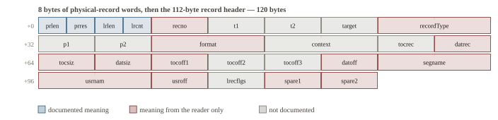

<!-- generated:bank RECORD_HEADER -->
<!-- table:bank-RECORD_HEADER -->
| # | Offset | Type | Field | Meaning | Basis |
|---|---|---|---|---|---|
| 1 | +0 | int16 | `prlen` | Physical record length (bytes). | template |
| 2 | +2 | int16 | `prres` | Reserved. | template |
| 3 | +4 | int16 | `lrlen` | Logical record length. | template |
| 4 | +6 | 16 bits | `lrcnt` | Continuation bits: 1 continued on next physical record, 2 continued from previous. | template |
| 5 | +8 | int32 | `recno` | Logical record number within the file. | reader only |
| 6 | +12 | int32 | `t1` | not documented | not documented |
| 7 | +16 | int32 | `t2` | not documented | not documented |
| 8 | +20 | int32 | `target` | not documented | not documented |
| 9 | +24 | 8 characters | `recordType` | Record type name; EVENT for event records, EOF ends the file. | reader only |
| 10 | +32 | int32 | `p1` | not documented | not documented |
| 11 | +36 | int32 | `p2` | not documented | not documented |
| 12 | +40 | 8 characters | `format` | Record format name; MINIDST marks a compressed mini-DST record. | reader only |
| 13 | +48 | 8 characters | `context` | not documented | not documented |
| 14 | +56 | int32 | `tocrec` | not documented | not documented |
| 15 | +60 | int32 | `datrec` | Nonzero when the data block starts in a later physical record. | reader only |
| 16 | +64 | int32 | `tocsiz` | Declared size of the table-of-contents section (bytes). | reader only |
| 17 | +68 | int32 | `datsiz` | Size of the compressed data block (bytes). | reader only |
| 18 | +72 | int32 | `tocoff1` | Byte offset of the PHMTOC table of contents. | reader only |
| 19 | +76 | int32 | `tocoff2` | not documented | not documented |
| 20 | +80 | int32 | `tocoff3` | not documented | not documented |
| 21 | +84 | int32 | `datoff` | Byte offset where the data block starts in its physical record. | reader only |
| 22 | +88 | 8 characters | `segname` | Segment name; MINIDST in mini-DST event records. | reader only |
| 23 | +96 | 8 characters | `usrnam` | Name of the user-header bank at usroff; IJEVHD, the event header. | reader only |
| 24 | +104 | int32 | `usroff` | Byte offset of the user-header bank (the event header). | reader only |
| 25 | +108 | int32 | `lrecflgs` | not documented | not documented |
| 26 | +112 | int32 | `spare1` | Spare word, unused. | reader only |
| 27 | +116 | int32 | `spare2` | Spare word, unused. | reader only |

Table: Fields of the logical record header.

Caveats:

- `prlen`: The template documents these four words for a file's first record; the reader finds them at the start of every physical record.
- `lrlen`: Holds 0 in the event records checked, and the reader ignores it.
- `recno`: The reader gives only the field name. The JIOHDR template [@johnson1991jiohdr] defines RECNO as the current logical record number of an open device, an in-memory field, and the stored values count the file's logical records from 1.
- `t1`: Read with t2 as the high longword, it decodes as a VMS time that increases record by record within a file, plausibly the write time. Untested.
- `t2`: Constant over long stretches of a file; see t1.
- `recordType`: The reader tests only for EOF, and its docs give DATA as an example value. EVENT is the value read in event records. The Jazelle help on JZIORH calls this word the record name [@jazellehelp].
- `p1`: Position and type fit the two application-defined parameters (PARAM) that the Jazelle help on JZIORH lists after the record name [@jazellehelp]; untested. Holds 1 in event records.
- `p2`: Second of the two PARAM words; see p1. Holds 1 in event records.
- `format`: The 1995 memo says Jazelle detects the compressed MiniDST format by itself but does not name this field [@junk1995compress].
- `context`: Holds JAZELLE in event records.
- `tocrec`: By analogy with datrec, the physical-record position of the TOC; 0 in event records.
- `datrec`: The reader only tests it for nonzero. Its value grows with the data size like the number of physical records the block fills; inferred, not documented.
- `tocsiz`: The reader says the value exceeds the PHMTOC size for an unknown reason. It equals the 32-byte event header plus the 72-byte (v4.0) or 68-byte (v3.0) PHMTOC, so the section seems to run from usroff to the end of the TOC.
- `tocoff2`: Equals the end of the PHMTOC in event records. The Jazelle routine JIOWLO writes up to three table-of-contents blocks, the second and third zero if unused [@jazellehelp], so this may locate an empty second block; untested.
- `tocoff3`: Equals tocoff2 in event records; possibly the empty third TOC block, see tocoff2.
- `segname`: The reader gives only the field name, and MINIDST is the value read in event records. The Jazelle help on JZIORH lists a segment name among the record-header contents [@jazellehelp], and the 1995 memo writes compressed records through an output segment list named MINIDST [@junk1995compress].
- `lrecflgs`: The name suggests logical-record flags; 0 in event records.

<!-- /generated:bank RECORD_HEADER -->

### IEVENTH

The event header holds the run and event numbers, the time, the weight, the event type and
the trigger word (Figure 4.26 and Table 4.14) [@johnson1990ieventh]. On disk it is stored as the 32-byte segment header
IJEVHD, which carries the same fields after a pointer to the header bank
[@johnson1988ijevhd]; the values of the event type are those of IEVENTH. In MC records the
run and event numbers are those of the overlaid random-trigger event, as
[the section on MC records](mc-records.md) explains.

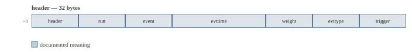

<!-- generated:bank IEVENTH -->
<!-- table:bank-IEVENTH -->
| # | Offset | Type | Field | Meaning | Basis |
|---|---|---|---|---|---|
| 1 | +0 | int32 | `header` | Pointer to the header bank in this segment, internal to Jazelle. | template |
| 2 | +4 | int32 | `run` | Run number. | template |
| 3 | +8 | int32 | `event` | Event number. | template |
| 4 | +12 | VAX date | `evttime` | Time when the event was created. | template |
| 5 | +20 | VAX F float | `weight` | Event weight (1.0 for real data). | template |
| 6 | +24 | int32 | `evttype` | Event type: 0 PHYSICS (real data), 1 TRUTH, 2 FASTMC, 3 SLOWMC (GEANT), 4 MIDMC. | template |
| 7 | +28 | int32 | `trigger` | Trigger mask of the event. | template |

Table: Fields of IEVENTH.

Caveats:

- `header`: Holds 0 in event records, so it carries no event information on disk.
- `run`: In MC it is the label of the overlaid random-trigger data event, shared by several MC records, so MC (run, event) does not identify the event.
- `event`: The reader docs add "within the run", which the templates do not state. In MC it is the overlaid random-trigger event's number; see run.
- `evttime`: The template gives no encoding. The reader decodes a VMS time (100 ns ticks since 17 Nov 1858) and subtracts 0.73 s more than the exact epoch offset. The reader docs call it a UTC timestamp, which no archived source states.
- `trigger`: Bit assignments are not documented (the template says TBA). In data, PHEVCL bits 18 (random), 23 (energy), 17 (luminosity Bhabha), 21 (track) and 19 (laser) follow trigger bits 0, 2, 3, 4 and 25. MC trigger words use another layout, with MC bit 18 in the role of data bit 2.

<!-- /generated:bank IEVENTH -->

### PHMTOC

The table of contents gives a format version and then one count per family, in its own
order (Figure 4.27 and Table 4.15). Not every compressed bank has a count: MCHEAD, which opens every data block, has
none, and the memo calls the table an incomplete list of the compressed banks
[@junk1995compress]. Together with the entry sizes, some of which are read from the
entries themselves, the counts fix where each family starts, and they are all the record
says about its contents.

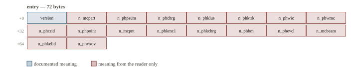

<!-- generated:bank PHMTOC -->
<!-- table:bank-PHMTOC -->
| # | Offset | Type | Field | Meaning | Basis |
|---|---|---|---|---|---|
| 1 | +0 | VAX F float | `version` | TOC format version (VAX F-float): 4.0 with 17 counts, 3.0 with 16. | memo |
| 2 | +4 | int32 | `n_mcpart` | Number of MCPART banks (generated particles); 0 in data. | reader only |
| 3 | +8 | int32 | `n_phpsum` | Number of PHPSUM banks (reconstructed particles). | reader only |
| 4 | +12 | int32 | `n_phchrg` | Number of PHCHRG banks (charged tracks). | reader only |
| 5 | +16 | int32 | `n_phklus` | Number of PHKLUS banks (calorimeter clusters). | reader only |
| 6 | +20 | int32 | `n_phktrk` | Number of PHKTRK banks; always 0. | reader only |
| 7 | +24 | int32 | `n_phwic` | Number of PHWIC banks (WIC muon-system entries). | reader only |
| 8 | +28 | int32 | `n_phwmc` | Number of PHWMC banks (MC truth of WIC muon-system clusters); 0 in data. | reader only |
| 9 | +32 | int32 | `n_phcrid` | Number of PHCRID banks (CRID particle identification). | reader only |
| 10 | +36 | int32 | `n_phpoint` | Number of PHPOINT banks (per-particle cross-references). | reader only |
| 11 | +40 | int32 | `n_mcpnt` | Number of MCPNT relations (reconstructed particles to MC particles); 0 in data. | reader only |
| 12 | +44 | int32 | `n_phkmc1` | Number of PHKMC1 relations (calorimeter clusters to MC particles); 0 in data. | reader only |
| 13 | +48 | int32 | `n_phkchrg` | Number of PHKCHRG relations (tracks to calorimeter clusters). | reader only |
| 14 | +52 | int32 | `n_phbm` | Number of PHBM banks; one per record. | reader only |
| 15 | +56 | int32 | `n_phevcl` | Number of PHEVCL banks; one per record. | reader only |
| 16 | +60 | int32 | `n_mcbeam` | Number of MCBEAM banks; one in MC, 0 in data. | reader only |
| 17 | +64 | int32 | `n_phkelid` | Number of PHKELID banks (calorimeter electron identification). | reader only |
| 18 | +68 | int32 | `n_phvxov` | Number of PHVXOV banks (VXD3 hit lists); version 4.0 only. | reader only |

Table: Fields of PHMTOC.

Caveats:

- `version`: The memo documents the version as the format switch; the values 4.0 and 3.0 are observed.
- `n_phktrk`: PHKTRK carries no bytes in these files. The 1995 memo records that PHKELID replaced PHKTRK in PHPOINT.

<!-- /generated:bank PHMTOC -->

## Beam and event: PHBM, PHEVCL and the reserved word

### PHBM

PHBM holds the beam conditions of the event (Figure 4.28 and Table 4.16): the centre-of-mass energy with its error, the
interaction point with a packed 3 × 3 error matrix, the signed polarisation of the
electron beam with its error, and the time between the event and the polarimeter
measurement it carries. The polarisation is negative for a left-handed electron beam. In
data the interaction point is the fitted IP of a block of consecutive events, and its z is
the event vertex where one was found [@banklab]. jazelle 0.4.0 reads the first 52 bytes and,
in MC records, reads them from the wrong place (the [format section](minidst.md) gives
the reason).

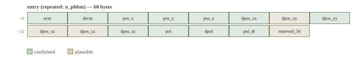

<!-- generated:bank PHBM -->
<!-- table:bank-PHBM -->
| # | Offset | Type | Field | Meaning | Basis |
|---|---|---|---|---|---|
| 1 | +0 | VAX F float | `ecm` | Centre-of-mass energy (GeV); -999 when not measured; MC smears the generated value. | confirmed |
| 2 | +4 | VAX F float | `decm` | Uncertainty or spread of ecm (GeV); -999 together with ecm; 0.05 in MC. | confirmed |
| 3 | +8 | VAX F float | `pos_x` | Interaction-point x (cm); 0 in MC. | confirmed |
| 4 | +12 | VAX F float | `pos_y` | Interaction-point y (cm); 0 in MC. | confirmed |
| 5 | +16 | VAX F float | `pos_z` | Event vertex z (cm); the IP-block z centre without a vertex; MC fallback -0.53 cm. | confirmed |
| 6 | +20 | VAX F float | `dpos_xx` | 1-sigma error (cm) of the IP-block fit in x; packed-matrix xx slot; fixed in MC. | confirmed |
| 7 | +24 | VAX F float | `dpos_xy` | xy slot of the packed IP error matrix; always 0. | plausible |
| 8 | +28 | VAX F float | `dpos_yy` | 1-sigma error (cm) of the IP-block fit in y; packed-matrix yy slot; fixed in MC. | confirmed |
| 9 | +32 | VAX F float | `dpos_xz` | xz slot of the packed IP error matrix; always 0. | plausible |
| 10 | +36 | VAX F float | `dpos_yz` | yz slot of the packed IP error matrix; always 0. | plausible |
| 11 | +40 | VAX F float | `dpos_zz` | Luminous-region length sigma_z of the IP block (cm); error of the pos_z fallback. | confirmed |
| 12 | +44 | VAX F float | `pol` | Signed e- beam polarisation, helicity times \|P\| (negative = left-handed); 0 if missing; MC ±1. | confirmed |
| 13 | +48 | VAX F float | `dpol` | Uncertainty of the assigned polarimeter measurement; 1 when pol is missing; 0 in MC. | confirmed |
| 14 | +52 | VAX F float | `pol_dt` | Days between the event and its polarimeter measurement; 999 none; 0 fixed average. | confirmed |
| 15 | +56 | 32 bits | `reserved_56` | Unused word, always 0; no status word or helicity sign (BPOL) stored. | plausible |

Table: Fields of PHBM.

Caveats:

- `pos_x`, `pos_y`: Shared by a block of consecutive events (an IP block). The reader comment says the IP comes from the SLC and the analysis code [@sldresurrect] cites beam-position monitors, but a refit of the block's VXD tracks reproduces it.
- `pos_z`: The reader docs and the analysis code treat pos_z as the IP z; the decoding specification finds a per-event vertex z [@banklab].
- `dpos_xx`, `dpos_yy`, `dpos_zz`: The reader calls dpos a symmetric error matrix; its diagonal holds sigmas, not variances.
- `pol`: The reader comment calls it the average polarisation measured by the Compton polarimeter (-1 to 1); the decoding specification finds the event's helicity sign times the measured magnitude [@banklab].
- `reserved_56`: The reader header keeps commented-out status and bpol fields; neither is stored here.

<!-- /generated:bank PHBM -->

### PHEVCL

PHEVCL classifies the event and summarises the detector status, in one 72-byte bank per
record (Figure 4.29 and Table 4.17). The 30-byte block of the 1996 template sits at +40: the event-class bit word, a
slot for the thrust axis, status words for the vertex detector, the drift chamber, the
calorimeter, the CRID and the muon system, and two condition words. The 40 bytes before it
lie outside the template. The words that are always zero are zero in all 919,189 readable
records, the holdout files included, and the thrust slot is among them, so PHEVCL carries
no thrust axis [@banklab]. jazelle 0.4.0 does not decode the bank: its parser stops at
PHBM, and its structure for PHEVCL follows the 30-byte template, not the 72 bytes on disk.

The event-class word `evtclass` records the results of the PASS1 and PASS2 filters, which
selected physics events and separated calibration streams such as random triggers, laser
records and track triggers [@duboisp1p2]. Recorded data use bits 6, 8, 14, 15, 17, 18, 19,
21, 23, 24, 25, 27, 28 and 29; the others, among them the template's candidate classes
MUMU, TAUTAU and QQ, are never set. The hadronic filter bits 14, 15 and
27 follow an independent hadronic selection with a correlation of about 0.93. Bit 8
(Bhabha) and bits 24 and 28 (muon pairs, checked against the muon system) pass physics
checks of their own. The PASS1 bit 24 also accepts cosmic rays, which the vertex cut of
bit 28 removes. Bits 17, 19 and 21 follow trigger bits of IEVENTH (see its caveats). Bit 6
measures how concentrated the energy is, so its template name ECTAUS, for τ pairs in the
endcaps, misleads. The names of bits 17, 19, 25 and 29 rest on the template alone
[@banklab].

The status words differ between data and MC. In recorded data the vertex-detector and
drift-chamber words are always zero, and the CRID word marks, in bit 0, a barrel whose high
voltage was low, in which case barrel tracks have no CRID entry. In MC the three words are
filled. Every MC record carries the raw data of a 1996 random-trigger event, and the words,
except drift-chamber bit 15, describe that event, not the simulated Z decay. The vertex-detector word, drift-chamber
bits 0 to 14 and the CRID word are identical in all records that share an overlay label.
Bit 18 of `evtclass`, the random trigger, is set in every MC record for the same reason.
Drift-chamber bits 0 to 9 mark superlayers that were off at that moment, and the
vertex-detector word goes with sectors dead in all three layers (see
[the section on MC records](mc-records.md)).

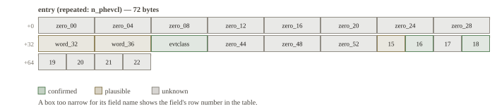

<!-- generated:bank PHEVCL -->
<!-- table:bank-PHEVCL -->
| # | Offset | Type | Field | Meaning | Basis |
|---|---|---|---|---|---|
| 1 | +0 | uint32 | `zero_00` | Always 0; not in the 1996 template (unfilled slot or padding). | unknown |
| 2 | +4 | uint32 | `zero_04` | Always 0; not in the 1996 template (unfilled slot or padding). | unknown |
| 3 | +8 | uint32 | `zero_08` | Always 0; not in the 1996 template (unfilled slot or padding). | unknown |
| 4 | +12 | uint32 | `zero_12` | Always 0; not in the 1996 template (unfilled slot or padding). | unknown |
| 5 | +16 | uint32 | `zero_16` | Always 0; not in the 1996 template (unfilled slot or padding). | unknown |
| 6 | +20 | uint32 | `zero_20` | Always 0; not in the 1996 template (unfilled slot or padding). | unknown |
| 7 | +24 | uint32 | `zero_24` | Always 0; not in the 1996 template (unfilled slot or padding). | unknown |
| 8 | +28 | uint32 | `zero_28` | Always 0; not in the 1996 template (unfilled slot or padding). | unknown |
| 9 | +32 | int32 | `word_32` | 0 whenever the event has charged tracks; leftover storage otherwise; purpose unknown. | plausible |
| 10 | +36 | int32 | `word_36` | 12 for 1-63 charged tracks, 0 for 64 or more; leftover without tracks; purpose unknown. | plausible |
| 11 | +40 | 32 bits | `evtclass` | Event-class bits, template EVTCLASS numbering; results of the PASS1 and PASS2 filters, calibration streams included; bits 17, 19, 25 and 29 are named from the template alone; bit 6: ECTAUS: energy concentration (template endcap tau filter, PASS1); bit 8: EE: e+e- candidate; bit 14: TAKAL2: left–right asymmetry tracking filter (PASS2); bit 15: TRKHAD2: tracking hadron filter (PASS2); bit 17: LUMBHA: luminosity Bhabha; bit 18: RNDMTRG: random trigger; bit 19: LASER: CDC laser record; bit 21: TRK: track trigger; bit 23: EIT: LAC energy trigger (PASS1); bit 24: MUPAIR: mu-pair filter (PASS1), which also accepts cosmic rays; bit 25: TAUPAIR: tau-pair filter (PASS1); bit 27: EIT2: LAC energy trigger (PASS2); bit 28: MUPAIR2: mu-pair filter (PASS2); bit 29: TAUPAIR2: tau-pair filter (PASS2) | confirmed |
| 12 | +44 | uint32 | `zero_44` | Always 0; template THRUST(3) x slot, never filled (no thrust axis stored). | unknown |
| 13 | +48 | uint32 | `zero_48` | Always 0; template THRUST(3) y slot, never filled. | unknown |
| 14 | +52 | uint32 | `zero_52` | Always 0; template THRUST(3) z slot, never filled. | unknown |
| 15 | +56 | 16 bits | `vxdstat` | MC-only VXD status code keyed to the overlaid random-trigger event; 0 in data. | plausible |
| 16 | +58 | 16 bits | `cdcstat` | MC-only CDC status; 0 in data; bit 15 is named from the template alone; bits 0-9: CDCHV0-CDCHV9: one bit per superlayer, set when its high voltage is off; bit 15: VETO: CDC would not have been read out | confirmed |
| 17 | +60 | uint16 | `zero_60` | Always 0; template KALSTAT slot, never filled. | unknown |
| 18 | +62 | 16 bits | `crdstat` | CRID status (template CRDSTAT); bit 0 BRLOFF is physics-checked, the other bit names come from the template; bit 0: BRLOFF: barrel high voltage low; bit 1: NOVCALB: no barrel velocity calibration; bit 2: XVCALB: poor barrel velocity calibration; bit 4: ECSOFF: south endcap high voltage low; bit 5: NOVCALES: no south endcap velocity calibration; bit 6: XVCALES: poor south endcap velocity calibration; bit 8: ECNOFF: north endcap high voltage low; bit 9: NOVCALEN: no north endcap velocity calibration; bit 10: XVCALEN: poor north endcap velocity calibration; bit 12: MANGLED: CRID raw data mangled or truncated; bit 13: LOCRvsDC: CRID data size suspiciously low against the drift chamber's | confirmed |
| 19 | +64 | uint16 | `zero_64` | Always 0; template WICSTAT slot, never filled. | unknown |
| 20 | +66 | uint16 | `word_66` | Template CONDITI1 slot, the condition flags of the raw-data consistency check STRGCHK; 0 in MC; data content not condition-like. | unknown |
| 21 | +68 | uint16 | `word_68` | Template CONDITI2 slot, the second word of STRGCHK condition flags; 0 in MC; data content not condition-like. | unknown |
| 22 | +70 | uint16 | `word_70` | Alignment word after the template block (1995 memo note 12); never written, leftover content. | unknown |

Table: Fields of PHEVCL.

Caveats:

- `word_32`: Only zeros are written, so the type is untested, and the relation repeats the writer condition of word_36.
- `word_36`: A 32-bit 12 cannot be told from a 16-bit 12 followed by a 16-bit 0.
- `evtclass`: MC simulates only bit 23; bit 18 and the rare others come from the overlaid random-trigger data event.
- `vxdstat`: Its main values go with VXD sectors dead in all three layers, but it is not a dead-sector bitmask, the bit-to-sector rule is unknown, and the mapping has no out-of-sample check. The template gives only the name.
- `crdstat`: Bit 12 failed its check on the holdout, and ECSOFF and ECNOFF could be swapped. Bits 1, 5, 6, 9 and 10 are always set together.

<!-- /generated:bank PHEVCL -->

The open part of PHEVCL is the meaning of five words and a few drift-chamber bits, the code
of the vertex-detector word, and the event-class and CRID bits named from the template alone
[@banklab]. The words and the drift-chamber bits are these:

1. **`word_32` and `word_36`.** They hold (0, 12) when the event has 1 to 63 tracks and
   (0, 0) with 64 to 114 tracks, a case seen in only 8 records; without tracks they hold
   leftover storage, for example (0x93c908, 0x906c3c).
2. **Data words +66 and +68**, the template's condition words. They are nonzero in 64% of
   data records and take about 270,000 different pairs of values. Even the most frequent
   pairs are rare: (0x1, 0) occurs in 3,480 and (0, 0x8000) in 3,156 of the 401,770
   nonzero records. The frequent pairs form integer sequences, such as (0x11, 6) to
   (0x15, 6), not patterns of independent flags, and they depend on nothing in the event
   beyond a weak link to the CRID status word (|r| ≤ 0.07). They read as storage left over
   from earlier processing. In MC they are zero.
3. **Data word +70**, the extra word that note 12 of the compressed-format memo mentions
   [@junk1995compress]. It is almost constant within a file and changes between files of
   one production job: in one 1997 job it is 0 in 95% of the first file's records and
   0xF1 in 91 to 94% of the other four files' records. That fits a value left over from
   earlier processing in each job, not one written for the event. In MC it varies
   arbitrarily from record to record.
4. **Drift-chamber bits 10 to 14**, which have no template names. They are set in 39 MC
   records, 4 or 5 records for each of 8 overlay labels, with one value per label (0x400
   in ten records, and 0x404, 0x2000, 0x2400, 0x2800, 0x3000 and 0x4400). Seven of the
   labels are busy events, with 130 to 374 clusters against a median of 52 in MC. The five
   records of the eighth, with the vertex-detector status 0xffff, have no clusters at all.
   The bits thus mark an abnormal random-trigger event, but what each bit means is unknown.
5. **Drift-chamber bit 15**, VETO in the template ("CDC would not have been read out").
   Unlike bits 0 to 14 it varies among records that share a label, so it appears to be set
   per simulated record, by a condition that is not known. It is anticorrelated with MC
   trigger bit 18 (r = −0.48), and the holdout has too few records with label partners to
   repeat the same-label test.

!!! recipe "Using PHEVCL"
    - Select events with the checked `evtclass` bits: 14, 15 and 27 for hadronic events,
      8 for Bhabha and 28 for muon pairs (bit 24, its PASS1 parent, also accepts cosmic
      rays).
    - Treat the words of unknown meaning as raw integers.
    - Compute the thrust axis from the tracks and clusters, since PHEVCL holds none.
    - In MC, read the status words, except drift-chamber bit 15, as conditions of the
      overlaid random trigger, not of the simulated event.

### The reserved word

One 4-byte word follows PHEVCL in data and MCBEAM in MC, before the PHVXOV banks. It is
zero in every record, present also when there are no PHVXOV banks, and the last word of
every record of the older table-of-contents version, which has no PHVXOV. It is therefore a
word of the older format: a reserved word or, untested, the count of a block that is always
empty [@banklab]. Table 4.18 lists it, and its caveat names the candidate block.

<!-- generated:bank GAP_WORD -->
<!-- table:bank-GAP_WORD -->
| # | Offset | Type | Field | Meaning | Basis |
|---|---|---|---|---|---|
| 1 | +0 | uint32 | `reserved_end_word` | Reserved word, always 0, closing the version-3 record; PHVXOV banks follow in v4.0. | plausible |

Table: Fields of the reserved word.

Caveats:

- `reserved_end_word`: An untested candidate from the archived documents is the in-record count (0 or 1) of MCPQRK, a compressed bank without a TOC count.

<!-- /generated:bank GAP_WORD -->

## Simulation truth: MCHEAD, MCPART, MCBEAM and PHWMC

### MCHEAD

MCHEAD opens the data block of every record (Figure 4.30 and Table 4.19). In MC it holds the number of final-state
particles of the generated event, a bit word of the generated process and the generated
interaction point; in data it is filled with zeros.

<!-- generated:bank MCHEAD -->
<!-- table:bank-MCHEAD -->
| # | Offset | Type | Field | Meaning | Basis |
|---|---|---|---|---|---|
| 1 | +0 | int32 | `ntot` | Total number of final-state particles in the generated event | template |
| 2 | +4 | int32 | `origin` | Event-type bit word: the bit of the generated process is set (see bits); bit 0: UUBAR: u ubar event; bit 1: DDBAR: d dbar event; bit 2: SSBAR: s sbar event; bit 3: CCBAR: c cbar event; bit 4: BBBAR: b bbar event; bit 5: TTBAR: t tbar event; bit 6: EE: e+e- event; bit 7: MUMU: mu+mu- event; bit 8: TAUTAU: tau+tau- event; bit 12: TWOPHOT: two-photon event | template |
| 3 | +8 | VAX F float | `ipx` | Generated interaction point x (cm, detector frame) | template |
| 4 | +12 | VAX F float | `ipy` | Generated interaction point y (cm, detector frame) | template |
| 5 | +16 | VAX F float | `ipz` | Generated interaction point z (cm, detector frame) | template |

Table: Fields of MCHEAD.

Caveats:

- `ntot`: Usually several times the number of MCPART entries stored in the mini-DST, so it counts particles the mini-DST did not keep. What exactly it counts has not been checked.
- `origin`: The reader header (MCHEAD.hpp) defines the template numbers as plain values, but the template calls them bits and the stored words have a single bit set (1, 2, 4, 8, 16), bit n matching the primary quark flavour 501+n. Read them as bit positions.
- `ipx`, `ipy`, `ipz`: The jazelle README calls them a primary-vertex momentum; they are a position, equal to MCBEAM ip_x, ip_y and ip_z.

<!-- /generated:bank MCHEAD -->

### MCPART

MCPART holds one entry per stored simulated particle, from the generator and from the
detector simulation (Figure 4.31 and Table 4.20). The particle code is not a PDG code: no surviving document defines
it, and the masses of two-body decays in the bank show that it matches the numbering of
JETSET 6 [@sjostrand1987jetset; @banklab]. One packed word holds the
entry's id, its parent's id, its charge and a flag for an omitted energy. The energy of
photons, neutrinos, electrons, muons, pions, kaons, protons and neutrons, whose masses the
compressor assumes, is omitted and must be rebuilt from the momentum and the mass
[@junk1995compress].

The MCPART of a mini-DST is not the full simulation record. About a fifth of the ids
survive (Table 4.3), and the kept set is closed under parent links: 99.2% of
the kept particles have a kept parent and the rest have none, so the compressor removed
whole branches of the decay tree, never a link inside a kept chain. The first ids, a
consecutive block 1..*k* with *k* between 33 and 235 (median 93), are always kept; they
hold the primary quarks and the generator history. 18.3% of the kept particles have a
cluster relation in PHKMC1. Which rule chose the rest, an energy threshold, the origin of
the particle in the generator or the detector simulation, or whether it or its descendants
left a track or a cluster, is not known [@issue50].

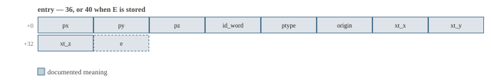

<!-- generated:bank MCPART -->
<!-- table:bank-MCPART -->
| # | Offset | Type | Field | Meaning | Basis |
|---|---|---|---|---|---|
| 1 | +0 | VAX F float | `px` | x momentum (GeV) of the particle at its point of origin | template |
| 2 | +4 | VAX F float | `py` | y momentum (GeV) of the particle at its point of origin | template |
| 3 | +8 | VAX F float | `pz` | z momentum (GeV) of the particle at its point of origin | template |
| 4 | +12 | uint32 | `id_word` | Packed word: own bank id, parent bank id, charge code and E-omitted flag; bits 0-12: MCPART bank id of this entry (template maximum 5000); bits 13-25: parent_id: Bank id of the parent MCPART entry (template PARENT key); bits 26-28: charge magnitude index: Index of \|charge\| in 0, 1/3, 2/3, 1, 2, 3, 4, 5 (units of e); bit 29: charge negative: Sign bit: set means the charge is negative; bit 30: E omitted: Set when E is not stored and must be rebuilt from the particle mass | memo |
| 5 | +16 | int32 | `ptype` | Particle type code, not a PDG id; numbering undocumented, inferred as JETSET 6 | template |
| 6 | +20 | int32 | `origin` | Bit word recording where the particle came from and how it ended (see bits); bit 0: DECAYED: decayed by the generator; bit 1: DECAYFLT: decayed in flight in the detector simulation; bit 2: BEAMPIPE: left down the beam pipe without hitting the detector; bit 3: NOINTER: traversed the detector without interacting; bit 4: STOPPED: energy below the cut; other bits may say why; bit 5: INTERACT: interacted; bit 6: INTSHDEP: interacted; outcome depends on the shower-deposition choice; bit 8: PRIMARY: from the e+e- primary interaction vertex; bit 9: ISTOP1: GEANT ISTOP=1 with KCASE not DCAY, HADR or photon PAIR; bit 10: ISTOP2: GEANT ISTOP=2 with KCASE not STOP; bit 11: KALTOCDC: shower albedo from the calorimeter back into the central detector; bit 12: SWERROR: error while tracking the particle through the detector; bit 13: SW2MNYST: tracking aborted after too many steps; bit 14: SWOUTOFT: tracking aborted outside the detector's sensitive time; bit 15: EMAXTERM: EM shower axis terminated at sufficient depth; bit 16: NOTTRACK: not tracked by request (e.g. neutrinos); bit 17: ISR: initial-state radiation; bit 18: BEAM: initial-state beam particle; bit 19: PREFRAG: pre-fragmentation particle (parton, gluon); bit 20: SWUM: produced by the detector simulation | template |
| 7 | +24 | VAX F float | `xt_x` | x (cm) of the termination point, where the particle decayed, interacted or stopped | template |
| 8 | +28 | VAX F float | `xt_y` | y (cm) of the termination point, where the particle decayed, interacted or stopped | template |
| 9 | +32 | VAX F float | `xt_z` | z (cm) of the termination point, where the particle decayed, interacted or stopped | template |
| 10 | +36 (if stored) | VAX F float | `e` | Energy (GeV); stored only for species outside the compressor's fixed mass list | template |

Table: Fields of MCPART.

Caveats:

- `id_word`: The memo fixes the content (13-bit ids, 4-bit charge, one E flag) but not the bit positions, which come from the reader (MCPART.cpp).
- `ptype`: The template names no numbering. The JETSET 6 reading (1 gamma, 7 e-, 8 nu_e, 9 mu-, 10 nu_mu, 12 nu_tau, 17 pi+, 18 K+, 23 pi0, 37 K0S, 38 K0L, 41 p, 42 n; quarks 501-505; negative for antiparticles) is inferred from two-body decay masses and production patterns, not documented. The Parnassus study [@lo2026parnassus] independently identifies codes 7-10 and 41-42 as e, nu_e, mu, nu_mu, p, n. The reader docs (MCPART.hpp, README) wrongly call it LUND/PDG.
- `origin`: Bit 8 (PRIMARY) was not seen set in a check of mini-DST MC records, so it cannot select generator particles.
- `e`: When E is omitted (gamma, nu, e, mu, pi, K, p, n, with the 1992 PDG masses [@junk1995compress]), jazelle <= 0.4.0 rebuilds it with masses in another numbering: e gets the K+ mass, mu the proton mass, nu_e the K0 mass, nu_mu the neutron mass and the photon the electron mass, while pi, K, p and n get zero.

<!-- /generated:bank MCPART -->

### MCBEAM

MCBEAM holds the generated beams (Figure 4.32 and Table 4.21): the label `XBEAM`, the generated interaction point, the
four-momentum of the colliding system and its invariant mass, the two beam four-momenta
and the helicity, ±1. The helicity follows the sign convention of PHBM's polarisation,
which in MC equals it. The data cannot say which beam is the electron, since reversing the
beam direction and the helicity gives the same events, so the fields are named beam 1 and
beam 2. The longitudinal momenta in MCBEAM have the opposite sign to the total momentum of
the generated final state in the detector frame, a convention the data do not explain
[@banklab]. jazelle 0.4.0 does not read this family.

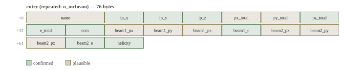

<!-- generated:bank MCBEAM -->
<!-- table:bank-MCBEAM -->
| # | Offset | Type | Field | Meaning | Basis |
|---|---|---|---|---|---|
| 1 | +0 | 8 characters | `name` | Entry label, always the string 'XBEAM   ' | plausible |
| 2 | +8 | VAX F float | `ip_x` | Generated interaction point x (cm, detector frame), equal to MCHEAD ipx | confirmed |
| 3 | +12 | VAX F float | `ip_y` | Generated interaction point y (cm, detector frame), equal to MCHEAD ipy | confirmed |
| 4 | +16 | VAX F float | `ip_z` | Generated interaction point z (cm, detector frame), equal to MCHEAD ipz | confirmed |
| 5 | +20 | VAX F float | `px_total` | x momentum of the e+e- system (GeV), always 0 | plausible |
| 6 | +24 | VAX F float | `py_total` | y momentum of the e+e- system (GeV), always 0 | plausible |
| 7 | +28 | VAX F float | `pz_total` | z momentum of the e+e- system (GeV), beam1_pz + beam2_pz, MCBEAM z convention | confirmed |
| 8 | +32 | VAX F float | `e_total` | Energy of the e+e- system (GeV), beam1_e + beam2_e | confirmed |
| 9 | +36 | VAX F float | `ecm` | Generated centre-of-mass energy sqrt(s) (GeV) | confirmed |
| 10 | +40 | VAX F float | `beam1_px` | Beam 1 x momentum (GeV), always 0 | plausible |
| 11 | +44 | VAX F float | `beam1_py` | Beam 1 y momentum (GeV), always 0 | plausible |
| 12 | +48 | VAX F float | `beam1_pz` | Beam 1 z momentum (GeV), equal to -beam1_e in MCBEAM's z convention | plausible |
| 13 | +52 | VAX F float | `beam1_e` | Beam 1 energy (GeV): the beam moving along +z in the detector frame | confirmed |
| 14 | +56 | VAX F float | `beam2_px` | Beam 2 x momentum (GeV), always 0 | plausible |
| 15 | +60 | VAX F float | `beam2_py` | Beam 2 y momentum (GeV), always 0 | plausible |
| 16 | +64 | VAX F float | `beam2_pz` | Beam 2 z momentum (GeV), equal to +beam2_e in MCBEAM's z convention | plausible |
| 17 | +68 | VAX F float | `beam2_e` | Beam 2 energy (GeV): the beam moving along -z in the detector frame | confirmed |
| 18 | +72 | VAX F float | `helicity` | Generated electron-beam helicity: -1 left-handed, +1 right-handed (full polarisation) | confirmed |

Table: Fields of MCBEAM.

Caveats:

- `pz_total`: Whether MCBEAM's momenta use a z-reversed generator frame or the generator applied the boost with the opposite sign cannot be told from the data.

<!-- /generated:bank MCBEAM -->

### PHWMC

PHWMC attributes the hits of each muon-system track to simulated particles (Figure 4.33 and Table 4.22). Unlike the
relation tables of the next section, it is not stored in two passes. Each bank is a 20-byte header followed
by one 8-byte pair per contribution: the particle's own hits (code 0),
hits of its interaction products (code 1) or hits with no particle (code 11). jazelle 0.4.0
reads the bank but calls the header words at +4, +8 and +12 `word1`, `word2` and
`total_count`, and the pair fields `id`, `count` and `value`.

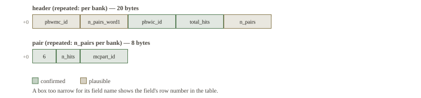

<!-- generated:bank PHWMC -->
<!-- table:bank-PHWMC -->
| # | Offset | Type | Field | Meaning | Basis |
|---|---|---|---|---|---|
| 1 | header +0 | int32 | `phwmc_id` | Bank id, 1..n in storage order | plausible |
| 2 | header +4 | int32 | `n_pairs_word1` | A count equal to n_pairs, most likely a second copy of the pair count | plausible |
| 3 | header +8 | int32 | `phwic_id` | Id of the PHWIC muon-system track whose hits this bank attributes | confirmed |
| 4 | header +12 | int32 | `total_hits` | Total number of hits of the WIC cluster, the sum of the pair hit counts | confirmed |
| 5 | header +16 | int32 | `n_pairs` | Number of 8-byte pairs that follow the header | plausible |
| 6 | pair +0 | uint16 | `contribution_code` | Hit origin: 0 own hits, 1 hits of its interaction products, 11 no MC particle | confirmed |
| 7 | pair +2 | uint16 | `n_hits` | Number of the cluster's hits attributed to this contribution | confirmed |
| 8 | pair +4 | int32 | `mcpart_id` | MCPART id of the particle that made the hits; 0 for code 11 | confirmed |

Table: Fields of PHWMC.

Caveats:

- `n_pairs_word1`: Whether the format reads the pair count from this word or from n_pairs is open.
- `phwic_id`: It always equals phwmc_id, so a pointer and a copy of the own id cannot be told apart.
- `contribution_code`: Code 11 hits are most likely background. The code describes the hits, not the particle: one particle can have a code-0 and a code-1 pair in the same bank.
- `mcpart_id`: Some ids point at particles the mini-DST did not keep, so the MCPART lookup can fail.

<!-- /generated:bank PHWMC -->

## Relation tables: MCPNT, PHKCHRG and PHKMC1

### MCPNT

MCPNT relates simulated particles to reconstructed particles (Figure 4.34 and Table 4.23). Each relation carries a
reason word, whose bits name the subsystems through which the particle contributed, the
number of tracking hits and the energy it gave the calorimeter cluster.

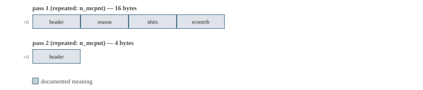

<!-- generated:bank MCPNT -->
<!-- table:bank-MCPNT -->
| # | Offset | Type | Field | Meaning | Basis |
|---|---|---|---|---|---|
| 1 | pass 1 +0 | uint32 | `header` | MCPNT id (high 16 bits) plus MCPART id (pass 1) or PHPOINT id (pass 2); bits 0-15: MCPART id: MCPART bank id of the MC particle; bits 16-31: MCPNT id: MCPNT bank id of this entry | memo |
| 2 | pass 1 +4 | int32 | `reason` | Bit word: why the two particles are related, by subsystem (see bits); bit 0: CDC hits of the MC particle contributed; bit 1: VTX: vertex-detector hits of the MC particle contributed; bit 2: EDCI: inner endcap drift chamber hits contributed; bit 3: EDCO: outer endcap drift chamber hits contributed; bit 4: WIC hits of the MC particle contributed; bit 8: KAL: the MC particle contributed energy to the calorimeter cluster; bit 24: VIRTUAL: the MC particle is identified with a virtual particle; bit 25: PARTIAL: one or more outgoing charged MC particles failed to be associated with the vertex | template |
| 3 | pass 1 +8 | int32 | `nhits` | Number of tracking-chamber hits the MC particle contributed | template |
| 4 | pass 1 +12 | VAX F float | `econtrib` | Energy (GeV, raw PHKLUS scale) the MC particle contributed to the calorimeter cluster | template |
| 5 | pass 2 +0 | uint32 | `header` | MCPNT id (high 16 bits) plus MCPART id (pass 1) or PHPOINT id (pass 2); bits 0-15: PHPOINT id: PHPOINT bank id of the reconstructed particle; bits 16-31: MCPNT id: MCPNT bank id, the key that joins pass 2 to pass 1 | memo |

Table: Fields of MCPNT.

Caveats:

- `header`: The memo describes the pass-2 pair of 16-bit ids; the pass-1 packing and the half order come from the reader. The decoding checks find the KAL-bit entries one to one with PHKMC1, which supports both ids.
- `nhits`: The reader treats -999 as no tracking hits. Calorimeter-only entries hold -999 or a positive count, whose meaning there is unchecked.

<!-- /generated:bank MCPNT -->

### PHKCHRG

PHKCHRG relates tracks to calorimeter clusters, in data and MC (Figure 4.35 and Table 4.24). Each relation joins one
PHCHRG track to one PHKLUS cluster and stores a match probability and two pulls. The pulls
compare the track, swum to the calorimeter, with the cluster's sub-cluster in the first
electromagnetic layer, EM1 [@banklab]:

$$
p_\theta = \frac{\cos\theta_{\mathrm{EM1}} - \cos\theta_{\mathrm{trk}}}{w_c},\qquad
p_\phi = \frac{\phi_{\mathrm{EM1}} - \phi_{\mathrm{trk}}}{w_\phi},
\label{eq:sld-phkchrg-pulls}
$$

where $w_c$ and $w_\phi$ are the RMS widths of the EM1 sub-cluster in cos θ and in φ, the
PHKLUS fields `wcth2` and `whphi2`. The swim depth is an effective one. The depth that best
fits the stored azimuthal pulls is r = 198 cm in the barrel and |z| = 232 cm in the
endcaps, a few centimetres behind the front faces of the LAC on which PHKMC1 records the
entry points (r = 192.7 cm in the barrel, |z| = 228 cm in the endcaps), and about 20 cm
beyond the inner wall of the barrel cryostat at r = 1.775 m. The fit fixes only B·r = 1.19 T m,
so r = 198 cm assumes a 0.6 T field. A track has at most one relation, while a cluster can
match several tracks: 16% of the matched clusters carry two or more, and they hold 35% of
the relations. The probability is stored between 0.01 and 1, relations below 0.01 are not
stored, and each cluster's PHPOINT track is its relation with the largest probability. jazelle 0.4.0 calls the probability
`match_distance`, and the polar and azimuthal pulls `delta_phi` and `delta_theta`, which
swaps the two angles.

No surviving document says how the reconstruction computed the probability, and the reader
returns the stored value unchanged. The stored values fit the χ² probability for two
degrees of freedom of the two angular residuals, with the EM1 widths and an angular error
$s$ added in quadrature [@banklab]:

$$
P = e^{-\chi^2/2},\qquad
\chi^2 = \frac{\Delta\theta^2}{w_\theta^2 + s^2} + \frac{\Delta\phi^2}{w_\phi^2 + s^2},
\label{eq:sld-phkchrg-chi2}
$$

with the polar width $w_\theta = w_c/\sin\theta_{\mathrm{trk}}$ and $s = 10$ mrad. Since
$\Delta\theta \approx -\Delta\cos\theta/\sin\theta$, in terms of the stored pulls this
reads

$$
\chi^2 = p_\theta^2\,\frac{w_c^2}{w_c^2 + s^2\sin^2\theta_{\mathrm{trk}}}
       + p_\phi^2\,\frac{w_\phi^2}{w_\phi^2 + s^2},
\label{eq:sld-phkchrg-chi2-pulls}
$$

with $\sin\theta_{\mathrm{trk}} = 1/\sqrt{1 + \tan^2\lambda}$, where $\tan\lambda$ is the
third helix parameter of PHCHRG. Two observations support the form. Solved entry by entry
where the polar pull is close to zero, the formula gives $s$ between 9.98 and 10.0 mrad
(lower and upper quartiles). Where the azimuthal pull is close to zero, the median is
10.0 mrad in every 0.1-wide bin of $|\cos\theta|$ up to 0.7. And for clusters one LAC tower
wide in φ, $w_\phi = 2\pi/192/\sqrt{12} = 9.4$ mrad, the formula predicts
$-2\ln P = 0.4716\,p_\phi^2$ when the polar pull is close to zero. 84% of those relations
sit at that value (91% in the holdout), and none at the values for 9 or 11 mrad.

Equation $\eqref{eq:sld-phkchrg-chi2}$ is a reconstruction from the data, and a partial
one [@banklab]:

- It reproduces the stored probability to 0.001 in 62% of 305,014 relations, 61% in data
  and 63% in MC. With the widths of the whole cluster in place of those of EM1, the share
  falls to 13%.
- It does best in the barrel, 69% for $|\cos\theta_{\mathrm{trk}}| < 0.7$ against 34%
  beyond, and for small polar pulls, 78% for $|p_\theta| \le 1$ against 40% above. It does
  worse for clusters shared by several tracks and for tracks without vertex-detector hits.
- In two thirds of the misses the stored χ² is smaller than the formula's, down to 0.3
  times at the 5th percentile, as if a further error term entered the denominator. In the
  other third it is larger, nine times in ten by less than 5%.
- The misses follow the track's extrapolation error. The formula reproduces about 70% of
  the relations whose track φ error at the calorimeter is below 5 mrad, 22% at 5 to
  10 mrad and 2 to 5% above, and 30% of those of tracks below 0.5 GeV.
- A design memo of 1987 planned to compare the (θ, φ) error matrices of both the track
  and the cluster [@dubois1987trkclu]. The track's helix covariance from PHCHRG,
  propagated to the calorimeter, is not the missing term: adding it to the denominator
  lowers the reproduced share from 62% to 38%, and using it as a lower bound on $s$
  changes nothing. Tracks with a large error account for about a third of the misses; the
  rest have small track errors and fall in the endcaps or on shared clusters.
- The 1.1% of relations whose cluster has an empty EM1 sub-cluster use another width. The azimuthal
  residual is not wrapped consistently at φ = 0, and the 0.4% of relations with
  $|p_\phi| \ge 50$ carry a jump of 2π, to which the formula does not apply.

The error model of the misses therefore remains open. It matters only for recomputing the
probability: an analysis reads the stored value.

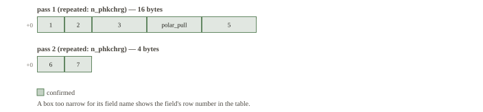

<!-- generated:bank PHKCHRG -->
<!-- table:bank-PHKCHRG -->
| # | Offset | Type | Field | Meaning | Basis |
|---|---|---|---|---|---|
| 1 | pass 1 +0 | uint16 | `phchrg_id` | PHCHRG id of the track (low half of the packed pass-1 word); each track appears at most once per record | confirmed |
| 2 | pass 1 +2 | uint16 | `phkchrg_id` | Relation id (high half), the key that joins the two passes | confirmed |
| 3 | pass 1 +4 | VAX F float | `match_probability` | Match probability, at least 0.01; for most relations the two-degree-of-freedom chi-squared probability of the EM1 residuals with 10 mrad added in quadrature | confirmed |
| 4 | pass 1 +8 | VAX F float | `polar_pull` | (cos theta of the EM1 sub-cluster - cos theta of the track) / wcth2 | confirmed |
| 5 | pass 1 +12 | VAX F float | `azimuthal_pull` | (phi of the EM1 sub-cluster - phi of the track) / whphi2, track swum to an effective depth, r = 198 cm or \|z\| = 232 cm | confirmed |
| 6 | pass 2 +0 | uint16 | `phklus_id` | PHKLUS id of the cluster; one cluster can match several tracks | confirmed |
| 7 | pass 2 +2 | uint16 | `phkchrg_id` | Relation id (high half), the key that joins the two passes | confirmed |

Table: Fields of PHKCHRG.

<!-- /generated:bank PHKCHRG -->

### PHKMC1

PHKMC1 relates simulated particles to calorimeter clusters (Figure 4.36 and Table 4.25): the energy each particle and
its shower left in the cluster, on the raw scale of the cluster energy, and the point where
the particle reached the calorimeter, or stopped before it. Its energies equal those of the
calorimeter relations of MCPNT. The relation ids follow the (cluster, particle) order of
the full record, and 69% of them survive. Every kept relation points to a particle and a
cluster that are in the record. The gaps fit relations removed together with their
particle, but whether the compressor also removed relations by a criterion of their own is
not known [@banklab; @issue50]. jazelle 0.4.0 skips this family.

A cluster without a PHKMC1 relation is, in most cases, not a particle whose link was lost
but a cluster of the overlaid random-trigger event. Among unlinked clusters, 93% of those
below 0.02 GeV and about 70% of those above 0.2 GeV have a byte-identical copy in another
record with the same overlay label, against at most 1.5% of linked clusters
([the section on MC records](mc-records.md)) [@issue50].

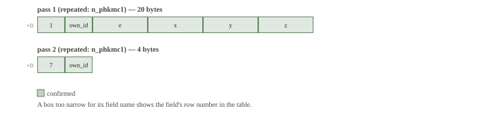

<!-- generated:bank PHKMC1 -->
<!-- table:bank-PHKMC1 -->
| # | Offset | Type | Field | Meaning | Basis |
|---|---|---|---|---|---|
| 1 | pass 1 +0 | uint16 | `mcpart_id` | MCPART id of the particle (low half of the packed pass-1 word) | confirmed |
| 2 | pass 1 +2 | uint16 | `own_id` | PHKMC1 relation id (high half), joining pass 1 to pass 2; skips dropped banks | confirmed |
| 3 | pass 1 +4 | VAX F float | `e` | Truth energy (GeV, raw PHKLUS scale) the particle and its shower left in the cluster | confirmed |
| 4 | pass 1 +8 | VAX F float | `x` | x (cm) where the particle entered the LAC, or its termination point if earlier | confirmed |
| 5 | pass 1 +12 | VAX F float | `y` | y (cm) where the particle entered the LAC, or its termination point if earlier | confirmed |
| 6 | pass 1 +16 | VAX F float | `z` | z (cm) where the particle entered the LAC, or its termination point if earlier | confirmed |
| 7 | pass 2 +0 | uint16 | `phklus_id` | PHKLUS id of the linked cluster (low half of the packed pass-2 word) | confirmed |
| 8 | pass 2 +2 | uint16 | `own_id` | PHKMC1 relation id (high half), joining pass 1 to pass 2; skips dropped banks | confirmed |

Table: Fields of PHKMC1.

Caveats:

- `e`: An estimate, equal to MCPNT econtrib: summed per cluster it follows eraw but does not partition it exactly.

<!-- /generated:bank PHKMC1 -->

## Open questions

The data leave these questions open [@banklab; @issue50]:

1. which simulated particles, calorimeter clusters and PHKMC1 relations the compressor
   kept, and by what rule, followed in
   [issue 50](https://github.com/HEP-KE/jazelle_reader/issues/50) of the reader;
2. the error model behind the 38% of PHKCHRG probabilities that equation
   $\eqref{eq:sld-phkchrg-chi2}$ does not reproduce;
3. what the PHEVCL words at +32, +36, +66, +68 and +70 and the drift-chamber status bits
   10 to 15 hold, how the vertex-detector word encodes dead sectors, and whether the
   event-class and CRID bits named from the template alone mean what their names say;
4. which of the two equal PHWMC header words, +4 or +16, is the pair count, and which of
   +0 and +8 is the PHWIC pointer;
5. the origin of the factors in the PHVXOV hit errors, and how the track inclination
   should enter the error along a CCD;
6. whether the words that are always zero in the records examined are ever nonzero
   elsewhere.

[The decoding section](decoding.md) states how far each of those words was checked. The
compressor sources would settle most of the other questions [@banklab; @issue50].

!!! summary "Key points"
    - The record header, IEVENTH and PHMTOC frame each event; the counts of PHMTOC are all
      the record says about its contents.
    - PHBM holds the centre-of-mass energy, the IP and the signed polarisation; PHEVCL
      the event class and, in MC, the detector status of the overlaid random trigger.
    - MCPART uses the JETSET 6 particle codes and keeps a subset of the simulation record;
      MCBEAM gives the generated beams and helicity.
    - MCPNT and PHKMC1 link reconstruction to truth and PHKCHRG links tracks to clusters,
      all three as two-pass tables joined on their relation ids; PHWMC attributes
      muon-system hits to MC particles.

## Further reading

The memo on the compressed format [@junk1995compress] lists the packing of the truth banks,
and issue 50 of the reader [@issue50] follows the question of which entries were kept.
