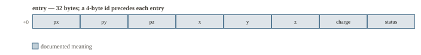
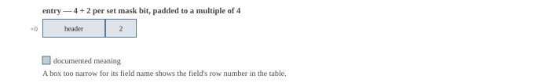
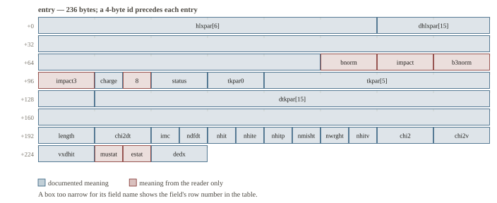
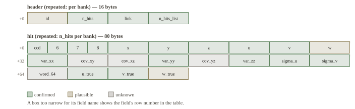
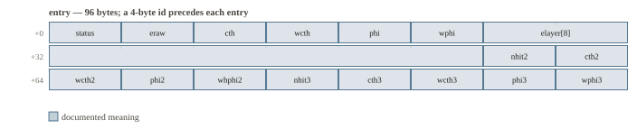
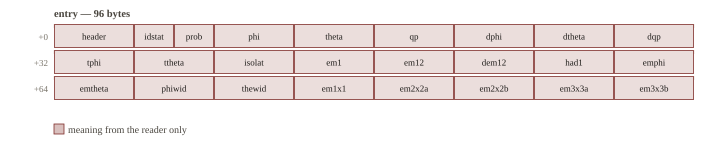
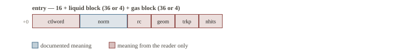
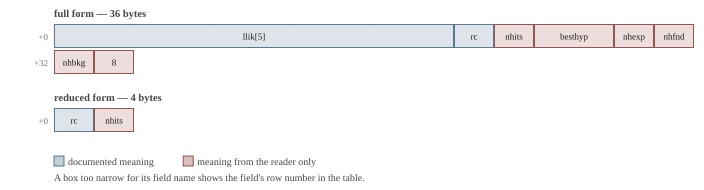
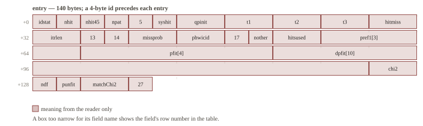

The reconstruction banks hold what the SLD reconstruction found in an event: tracks,
vertex-detector hits, calorimeter clusters and the particle identification attached to
them. Each figure below is a byte map of one entry, coloured by the basis of each field's
meaning, and each table lists the fields in the order of the map. The basis says where the
meaning comes from: an archived bank template, the mini-DST memos of 1994 and 1995
[@strauss1994mdst; @junk1995compress], a published paper, the reader's own documentation
only [@jazellereader], or, for fields decoded from the data, the label of the decoding
procedure [@banklab]. The caveats under each table name the documents behind a reading:
the offline workbook [@sldworkbook], the notes on reconstructions 12 and 12A
[@recon12; @recon12a], the templates of the drift-chamber banks
[@phdctemplate; @phdcvtemplate], the dataset paper [@cheng2026aiready] and the analysis code
[@sldresurrect]; "the reader header" and "the reader source" are the comments in the C++
header and source files of jazelle 0.4.0. In the Type column, intN and uintN are signed
and unsigned N-bit integers, "16 bits" and "32 bits" a word read as a bit pattern, VAX F
float a 32-bit VAX floating-point number, VAX date the 64-bit VMS time, "8 characters" an
ASCII text field and N × T an array of N values of type T. Offsets count from the start of
the entry, after the separate id word where there is one.

## Particles: PHPSUM and PHPOINT

### PHPSUM

PHPSUM is the particle summary (Figure 4.16 and Table 4.4): one entry per reconstructed particle, a charged track or a
neutral calorimeter cluster, with its momentum, the point it starts from and its charge.
It is the family an analysis reads first, since every track and every neutral cluster
appears in it once.

<!-- generated:bank PHPSUM -->
<!-- table:bank-PHPSUM -->
| # | Offset | Type | Field | Meaning | Basis |
|---|---|---|---|---|---|
| 1 | +0 | VAX F float | `px` | x momentum (GeV) of the particle at its track origin | template |
| 2 | +4 | VAX F float | `py` | y momentum (GeV) of the particle at its track origin | template |
| 3 | +8 | VAX F float | `pz` | z momentum (GeV) of the particle at its track origin | template |
| 4 | +12 | VAX F float | `x` | x position (cm) at which the momentum is given | template |
| 5 | +16 | VAX F float | `y` | y position (cm) at which the momentum is given | template |
| 6 | +20 | VAX F float | `z` | z position (cm) at which the momentum is given | template |
| 7 | +24 | VAX F float | `charge` | particle charge, stored as a real number | template |
| 8 | +28 | int32 | `status` | status bits, bit 0 (CUTFLAG) excludes the particle from jet and shape finding | template |

Table: Fields of PHPSUM.

Caveats:

- `px`: The 1994 memo speaks of a four-momentum, but the bank stores only the 3-momentum. The energy follows from a mass hypothesis. The template gives no unit. GeV is supported by the dilepton mass peak at M_Z in the dataset paper, whose event four-vectors come from PHPSUM.
- `x`: The reader README calls x, y, z a geometric event-vertex summary, which contradicts the template's per-particle position. The template gives no unit. The cm is supported by the impact-parameter cuts of the sld-resurrect analysis, set in cm.
- `charge`: The reader README calls it the total measured charge, which contradicts the template.
- `status`: CUTFLAG is a user flag set during analysis. Other bits are not documented.

<!-- /generated:bank PHPSUM -->

### PHPOINT

PHPOINT ties the pieces of one particle together. It has one entry per PHPSUM particle,
holding the ids of the particle's PHPSUM, PHCHRG, PHKLUS, PHKELID, PHWIC and PHCRID
entries where they exist. A mask in the high half of the first word says which ids follow,
one 16-bit id per set bit, in the order of the bits (Figure 4.17 and Table 4.5)
[@junk1995compress; @jazellereader]. Where a track and a cluster belong to one particle, the pairing follows the track–cluster
table PHKCHRG of [the next section](banks-event-truth.md): the cluster goes to the track
of its relation with the largest match probability, without exception in the 228,286
relations checked [@banklab].

<!-- generated:bank PHPOINT -->
<!-- table:bank-PHPOINT -->
| # | Offset | Type | Field | Meaning | Basis |
|---|---|---|---|---|---|
| 1 | +0 | uint32 | `header` | PHPOINT id (bits 0-15) and mask of stored pointers (bits 16-31) | memo |
| 2 | +4 | number of set mask bits × int16 | `pointers` | 16-bit bank ids of the linked entries, stored only for set mask bits; bit 0: PHPSUM id, and when clear the PHPSUM id equals the PHPOINT id; bit 1: PHCRID: CRID (Cherenkov) entry; bit 2: PHCHRG: charged-track entry; bit 3: PHKLUS: calorimeter-cluster entry; bit 4: PHKELID: electron-identification (calorimeter hypothesis) entry; bit 5: PHWIC: muon-system (WIC) entry | memo |

Table: Fields of PHPOINT.

Caveats:

- `header`: The memo says the id and the pointer mask share one word but gives no bit positions. The split at bit 16 is the reader's (PHPOINT.cpp).
- `pointers`: The mask-bit assignments in the table are the reader's, and their order differs from the template's pointer order. The memo says the PHPSUM pointer is omitted when the PHPSUM id equals the PHPOINT id, flagged by one bit, and that zero pointers are not stored. A data check supports bits 2 and 3: under this order every charged PHPSUM entry has a PHCHRG pointer and every neutral one a PHKLUS pointer. Bits 1, 4 and 5 are not checked.

<!-- /generated:bank PHPOINT -->

## Tracking: PHCHRG and PHVXOV

### PHCHRG

PHCHRG holds one entry per reconstructed charged track, from the combined fit of the
drift chamber and the vertex detector. The helix parameters `hlxpar` are the azimuth
$\phi_0$, the inverse transverse momentum $1/\pT$, the dip $\tan\lambda$ and the point
(x, y, z) of the track. The inverse momentum, `hlxpar(2)` in the templates' numbering from
one, is stored without sign and the charge is a separate field, so

$$
p_x = \frac{\cos\phi_0}{|\mathtt{hlxpar}(2)|},\qquad
p_y = \frac{\sin\phi_0}{|\mathtt{hlxpar}(2)|},\qquad
p_z = \frac{\tan\lambda}{|\mathtt{hlxpar}(2)|}.
\label{eq:sld-phchrg-momentum}
$$

`dhlxpar` packs the symmetric 5 × 5 error matrix of the five fit parameters into 15
numbers, and `tkpar` with `dtkpar` repeat the exercise for the track parameters at the
first drift-chamber hit. The hit counts, fit quality, the bit mask of VXD3 layers hit and
the encoded ionisation loss follow [@jazellereader], as Figure 4.18 and Table 4.6 show. No
PHCHRG template survives beyond its header, the `hlxpar` line and one note, quoted in the
offline workbook [@sldworkbook]. Apart from `hlxpar`, `dhlxpar` and `dedx`, which rest on
that quoted template, fields whose basis is a template take the definition of the word of
the same name in the PHDC and PHDCV templates [@phdctemplate; @phdcvtemplate],
from which the 1994 memo says PHCHRG was compiled [@strauss1994mdst].

<!-- generated:bank PHCHRG -->
<!-- table:bank-PHCHRG -->
| # | Offset | Type | Field | Meaning | Basis |
|---|---|---|---|---|---|
| 1 | +0 | 6 × VAX F float | `hlxpar` | helix phi (rad), 1/pT (1/GeV), tan(lambda), and reference point x, y, z (cm) | template |
| 2 | +24 | 15 × VAX F float | `dhlxpar` | covariance of (phi, 1/pT, tan lambda, TSI, ETA), 15 packed elements | template |
| 3 | +84 | VAX F float | `bnorm` | normalisation of the 2D impact parameter | reader only |
| 4 | +88 | VAX F float | `impact` | 2D impact parameter (cm) | reader only |
| 5 | +92 | VAX F float | `b3norm` | normalisation of the 3D impact parameter | reader only |
| 6 | +96 | VAX F float | `impact3` | 3D impact parameter (cm) | reader only |
| 7 | +100 | int16 | `charge` | track charge, +1 or -1 | paper |
| 8 | +102 | int16 | `smwstat` | status of the swim (extrapolation) of the track to the beam line | reader only |
| 9 | +104 | int32 | `status` | track status bits, including a CUTFLAG bit that excludes the track from jet finding | memo |
| 10 | +108 | VAX F float | `tkpar0` | zero track parameter: radius rho (cm) of the first CDC hit | template |
| 11 | +112 | 5 × VAX F float | `tkpar` | parameters at first CDC hit: xphi (rad), z (cm), phi, lambda (rad), q/pT (1/GeV) | template |
| 12 | +132 | 15 × VAX F float | `dtkpar` | error matrix of tkpar, packed (1,1), (2,1), (2,2), (3,1), ... | template |
| 13 | +192 | VAX F float | `length` | fitted track length (cm) | template |
| 14 | +196 | VAX F float | `chi2dt` | chi-squared of the CDC drift-time fit | template |
| 15 | +200 | int16 | `imc` | MC only: Monte Carlo track id, the MCPART id of the track's particle | template |
| 16 | +202 | int16 | `ndfdt` | degrees of freedom of the drift-time fit chi2dt | template |
| 17 | +204 | int16 | `nhit` | number of CDC hits used in the drift-time fit | template |
| 18 | +206 | int16 | `nhite` | number of expected CDC hits | template |
| 19 | +208 | int16 | `nhitp` | number of potential CDC hits | template |
| 20 | +210 | int16 | `nmisht` | MC only: number of missing hits | template |
| 21 | +212 | int16 | `nwrght` | MC only: number of wrongly associated hits | template |
| 22 | +214 | int16 | `nhitv` | number of VXD hits used in the combined CDC+VXD fit | template |
| 23 | +216 | VAX F float | `chi2` | total chi-squared of the combined CDC+VXD fit | template |
| 24 | +220 | VAX F float | `chi2v` | chi-squared contribution from the VXD hits | template |
| 25 | +224 | int32 | `vxdhit` | bit pattern of the VXD3 sub-layers hit, bits 0-11 | template |
| 26 | +228 | int16 | `mustat` | muon (WIC) identification status code | reader only |
| 27 | +230 | int16 | `estat` | electron identification status code | reader only |
| 28 | +232 | int32 | `dedx` | CDC dE/dx word, a 32-bit integer of undocumented encoding | template |

Table: Fields of PHCHRG.

Caveats:

- `hlxpar`: The template gives no units, and the SLD Workbook gives HLXPAR(2) in 1/GeV. 1/pT is stored positive for both charges, and the sign is in charge. The notes on reconstruction 12A put the reference point at the closest approach to the beam line, except for tracks whose swim was not attempted (SWMSTAT 30).
- `dhlxpar`: TSI and ETA are the two distances of the helix from a reference point that note 3 of the PHCHRG template defines (TSI = TN.DELTA, ETA = TQ.DELTA). The packing order (1,1), (2,1), (2,2), (3,1), ... is stated for DTKPAR in the PHDC template, not for DHLXPAR. The data check under bnorm fits it.
- `bnorm`, `impact`: The reader header calls bnorm the 2D impact parameter and impact its error or significance, the reverse of the reader source. The SLD Workbook uses IMPACT as the impact parameter in cm, which sides with the source. In a data check impact/bnorm equals the square root of dhlxpar element 10 (the TSI variance), so bnorm reads as the impact-parameter significance, which no document states. The stored impact has no sign in the data checked, and its reference point is not documented.
- `b3norm`, `impact3`: The reader header calls b3norm the 3D impact parameter and impact3 its error or significance, the reverse of the reader source. The reconstruction-12 notes call the pair (IMPACT3, B3NORM) the 3D impact parameter values, computed with correct IP handling from reconstruction 12 on, and speak of the impact parameter and its error estimate without saying which word holds which. Both hold -999 when the 3D impact parameter was not computed.
- `smwstat`: The SLD reconstruction notes spell the word SWMSTAT. They document only the value 30, swim not attempted, for which hlxpar is not at the closest approach to the beam line. The same notes say reconstruction 12A swam those tracks. Other codes are not documented.
- `status`: The bit position of CUTFLAG in PHCHRG is not documented (it is bit 0 in the PHPSUM template). Stored tracks carry several low bits set by the reconstruction, whose meanings are not documented.
- `tkpar0`: PHCHRG does not store REFSYS. In the endcap reference system the zero parameter would be z instead of rho. The reader calls it the initial or reference-point track parameter.
- `tkpar`: The PHDC template names the first parameter PHI, the PHDCV template XPHI, the azimuth of the starting point. A data check agrees with the PHDCV order: tkpar(4) closely follows the arctangent of hlxpar tan(lambda) and the sign of tkpar(5) is the charge. The templates give no units. The reader calls tkpar alternative fit parameters, for example at the calorimeter face.
- `length`: The template gives no unit, so the cm is an assumption.
- `nhit`: PHDCV also has an NHIT, the total number of hits in the combined CDC+VXD fit, and the reader's "total number of hits on track" fits that one. The PHDC reading rests on the position of nhit among the PHDC words (chi2dt, ndfdt, nhite, nhitp).
- `nhitp`: The reader header calls it the number of hits used in the final fit. The reader source and the PHDC template call it the number of potential hits.
- `nwrght`: The reader source calls them wrong-way hits and the reader header wrong or noise hits. The PHDC template says wrong associated hits, filled for MC tracks.
- `vxdhit`: PHDCV holds this as a 16-bit word followed by the 16-bit HITEXP, the sub-layers hit by the MC track. PHCHRG stores one 32-bit word, and in MC its bits 16-27 repeat the sub-layers whose hit comes from the track's own MC particle (the PHVXOV decoding), which fits HITEXP.
- `mustat`, `estat`: The codes are not documented. The PHCHRG template, as the SLD Workbook quotes it, gives the word a nonzero default value.
- `dedx`: The encoding is not documented. PHDC stores DEDX, DDEDX and NHITDE as separate words, so the 32-bit word may pack several of them. The reader exposes the raw integer.

<!-- /generated:bank PHCHRG -->

### PHVXOV

PHVXOV holds the VXD3 hits of one track candidate (Figure 4.19 and Table 4.7): a 16-byte header, then one 80-byte
entry per hit. A bank either belongs to a PHCHRG track, whose id is its `link`, or is a
vertex-detector-only candidate with `link` 0. The CCD number runs from 1 to 96 over the 96
CCDs of the detector [@abe1997vxd3]: CCDs 1 to 24 form the inner layer, 25 to 56 the middle
and 57 to 96 the outer one, and an odd number marks the half of a ladder at negative z.
jazelle 0.4.0 does not read this family. Its field names, labels and meanings, this CCD
assignment among them, come from the decoding procedure and are not yet released [@banklab].

<!-- generated:bank PHVXOV -->
<!-- table:bank-PHVXOV -->
| # | Offset | Type | Field | Meaning | Basis |
|---|---|---|---|---|---|
| 1 | header +0 | int32 | `id` | bank id: position of the bank in the record, 1 to n_phvxov | plausible |
| 2 | header +4 | int32 | `n_hits` | number of VXD hits in the bank, each an 80-byte hit entry | confirmed |
| 3 | header +8 | int32 | `link` | PHCHRG id of the track owning the hits, 0 for a VXD-only candidate | confirmed |
| 4 | header +12 | int32 | `n_hits_list` | repeat of n_hits, one copy possibly the converter's block-length word | confirmed |
| 5 | hit +0 | int16 | `ccd` | CCD 1-96 (layer 1: 1-24, 2: 25-56, 3: 57-96), odd z<0, even z>0 | confirmed |
| 6 | hit +2 | int16 | `mc_particle` | MC: MCPART id of the particle that made the hit, -9999 if none or data | confirmed |
| 7 | hit +4 | int16 | `n_pixels` | cluster size in pixels | confirmed |
| 8 | hit +6 | int16 | `pulse_height` | cluster pulse height, summed ADC counts | confirmed |
| 9 | hit +8 | VAX F float | `x` | global hit x (cm), SLD detector frame | confirmed |
| 10 | hit +12 | VAX F float | `y` | global hit y (cm), SLD detector frame | confirmed |
| 11 | hit +16 | VAX F float | `z` | global hit z (cm), SLD detector frame | confirmed |
| 12 | hit +20 | VAX F float | `u` | local coordinate across the CCD (cm, 0 to 1.6), increasing with azimuth | confirmed |
| 13 | hit +24 | VAX F float | `v` | local coordinate along the CCD (cm, 0 to 8.0), from its end near z=0 | confirmed |
| 14 | hit +28 | VAX F float | `w` | local coordinate normal to the CCD (cm): CCD surface height, constant -0.0013 in MC | plausible |
| 15 | hit +32 | VAX F float | `var_xx` | global covariance xx (cm^2) = (2 sigma_u)^2 sin^2(phi_hit), phi_hit being the azimuth of the hit | confirmed |
| 16 | hit +36 | VAX F float | `cov_xy` | always 0, xy slot of the packed covariance [xx, xy, xz, yy, yz, zz] | unknown |
| 17 | hit +40 | VAX F float | `cov_xz` | always 0, xz slot of the packed covariance | unknown |
| 18 | hit +44 | VAX F float | `var_yy` | global covariance yy (cm^2) = (2 sigma_u)^2 cos^2(phi_hit) | confirmed |
| 19 | hit +48 | VAX F float | `cov_yz` | always 0, yz slot of the packed covariance | unknown |
| 20 | hit +52 | VAX F float | `var_zz` | global covariance zz (cm^2) = (2 sigma_v)^2 | confirmed |
| 21 | hit +56 | VAX F float | `sigma_u` | cluster position error across the CCD (cm), (pitch/sqrt 12) 2^(-3/4) for one-pixel clusters, with the 20 µm pixel pitch | confirmed |
| 22 | hit +60 | VAX F float | `sigma_v` | cluster position error along the CCD (cm), same one-pixel cap as sigma_u | confirmed |
| 23 | hit +64 | 32 bits | `word_64` | always 0 | unknown |
| 24 | hit +68 | VAX F float | `u_true` | MC: true local u (cm), 0 without an MC particle and in data | confirmed |
| 25 | hit +72 | VAX F float | `v_true` | MC: true local v (cm), 0 without an MC particle and in data | confirmed |
| 26 | hit +76 | VAX F float | `w_true` | MC: true local w (cm), constant -0.001195, 0 without an MC particle | plausible |

Table: Fields of PHVXOV.

Caveats:

- `link`: VXD-only candidates (link 0) can share hits with other banks and need not be distinct particles.
- `n_hits_list`: The label covers the value. The data cannot tell which of the two copies is the bank attribute and which the length word.
- `w`: Data-derived only. In data it is a fixed surface map of each CCD, and no physics check reaches it.
- `w_true`: A constant, so no physics check reaches it. 0 in all data.

<!-- /generated:bank PHVXOV -->

!!! warning "The stored hit errors are not unit pulls"
    The covariance diagonal of a hit is four times its squared cluster error, the error of
    a one-pixel cluster is capped below the measured residual, and the error along the CCD
    ignores the inclination of the track [@banklab]. Neither the stored errors nor the
    covariance can enter a track fit without calibration against the simulation truth.

## Calorimetry: PHKLUS and PHKELID

### PHKLUS

PHKLUS holds one entry per stored cluster of the liquid argon calorimeter (Figure 4.20 and Table 4.8): the raw cluster
energy, its energy-weighted direction and widths, the energy in each layer, and the
direction and widths of the cluster in the first two electromagnetic layers, EM1 and EM2.
The fields `wcth` and `wphi` and their EM1 and EM2 versions are RMS widths, not
energy-weighted directions, and the two sub-clusters are the EM1 and EM2 layers, not the
electromagnetic and hadronic sections; the header file and README of jazelle 0.4.0 state
both wrongly, while its source comments have them right [@banklab]. A sub-cluster is
present exactly when its layer holds energy. An empty EM1 sub-cluster is common: a scan
of one 1997 data file and one 1996 MC file with jazelle 0.4.0 finds it in 15.1% and 11.5% of
the stored clusters [@jazellereader]. Only 1.1% of the track–cluster relations of PHKCHRG
involve such a cluster [@banklab]. The EM1 direction and widths are what the
track–cluster match of PHKCHRG compares with the track.

Only about a quarter of the cluster ids survive in a record, 22% in recorded data and 27%
in MC, and the clusters that remain keep their full-DST ids. Why the compressor removed
the others is not known [@issue50].

<!-- generated:bank PHKLUS -->
<!-- table:bank-PHKLUS -->
| # | Offset | Type | Field | Meaning | Basis |
|---|---|---|---|---|---|
| 1 | +0 | int32 | `status` | Cluster status bits; the CUTFLAG bit excludes the cluster from jet and shape finding. | memo |
| 2 | +4 | VAX F float | `eraw` | Raw cluster energy before e/pi correction, in GeV at the minimum-ionising (MIP) scale. | template |
| 3 | +8 | VAX F float | `cth` | Energy-weighted mean cos(theta) of the cluster. | template |
| 4 | +12 | VAX F float | `wcth` | Width (RMS) of the cluster energy in cos(theta). | template |
| 5 | +16 | VAX F float | `phi` | Energy-weighted mean azimuth of the cluster, radians. | template |
| 6 | +20 | VAX F float | `wphi` | Width (RMS) of the cluster energy in phi, radians; one tower gives 2pi/192/sqrt(12). | template |
| 7 | +24 | 8 × VAX F float | `elayer` | Layer energies (MIP scale): luminosity-monitor EM1/EM2, LAC EM1/EM2/HAD1/HAD2, WIC pads 1/2. | template |
| 8 | +56 | int32 | `nhit2` | Number of towers hit in LAC EM1. | template |
| 9 | +60 | VAX F float | `cth2` | Energy-weighted mean cos(theta) of the cluster in LAC EM1. | template |
| 10 | +64 | VAX F float | `wcth2` | Width (RMS) of the cluster energy in cos(theta) in LAC EM1. | template |
| 11 | +68 | VAX F float | `phi2` | Energy-weighted mean azimuth of the cluster in LAC EM1, radians. | template |
| 12 | +72 | VAX F float | `whphi2` | Width (RMS) of the cluster energy in phi in LAC EM1, radians. | template |
| 13 | +76 | int32 | `nhit3` | Number of towers hit in LAC EM2. | template |
| 14 | +80 | VAX F float | `cth3` | Energy-weighted mean cos(theta) of the cluster in LAC EM2. | template |
| 15 | +84 | VAX F float | `wcth3` | Width (RMS) of the cluster energy in cos(theta) in LAC EM2. | template |
| 16 | +88 | VAX F float | `phi3` | Energy-weighted mean azimuth of the cluster in LAC EM2, radians. | template |
| 17 | +92 | VAX F float | `wphi3` | Width (RMS) of the cluster energy in phi in LAC EM2, radians. | template |

Table: Fields of PHKLUS.

Caveats:

- `status`: No other bit is documented; the reader header's barrel/endcap reading has no source.
- `eraw`: The SLD Workbook labels its example bank fictitious, so the template origin of eraw, cth, wcth, phi and wphi is inferred. GeV and MIP scale are inferred: eraw equals the elayer sum.
- `elayer`: The MIP-scale wording comes from the fictitious example bank and an example macro of the SLD Workbook; the layer order comes from the Workbook's description of PHKLUS.

<!-- /generated:bank PHKLUS -->

### PHKELID and PHKTRK

PHKELID identifies electrons from their showers. It has one entry per charged track that
was evaluated: the angular and momentum match between the track and its cluster, the
energies of the electromagnetic layers and the first hadronic layer, and energy sums in
windows of towers around the track (Figure 4.21 and Table 4.9). Its first word holds its
own id in the low half and the id of its PHCHRG track in the high half. PHKELID replaced PHKTRK, the
electron-identification bank of the 1994 mini-DST, as a PHPOINT pointer
[@strauss1994mdst; @junk1995compress], and the PHKTRK count is 0 in every readable record
[@banklab].

<!-- generated:bank PHKELID -->
<!-- table:bank-PHKELID -->
| # | Offset | Type | Field | Meaning | Basis |
|---|---|---|---|---|---|
| 1 | +0 | uint32 | `header` | Bits 0-15 entry id; bits 16-31 id of the evaluated PHCHRG track. | reader only |
| 2 | +4 | int16 | `idstat` | Electron-identification status code of the track. | reader only |
| 3 | +6 | int16 | `prob` | Probability or confidence level of the electron hypothesis, as a 16-bit integer. | reader only |
| 4 | +8 | VAX F float | `phi` | Azimuth at the calorimeter, of the extrapolated track or of the cluster; radians. | reader only |
| 5 | +12 | VAX F float | `theta` | Polar angle at the calorimeter, of the extrapolated track or of the cluster; radians. | reader only |
| 6 | +16 | VAX F float | `qp` | Charge over momentum of the track, 1/GeV. | reader only |
| 7 | +20 | VAX F float | `dphi` | Uncertainty of the phi match, or track-cluster phi difference; radians. | reader only |
| 8 | +24 | VAX F float | `dtheta` | Uncertainty of the theta match, or track-cluster theta difference; radians. | reader only |
| 9 | +28 | VAX F float | `dqp` | Uncertainty of qp, 1/GeV. | reader only |
| 10 | +32 | VAX F float | `tphi` | Azimuth from the track extrapolation, or of the cluster centroid; radians. | reader only |
| 11 | +36 | VAX F float | `ttheta` | Polar angle from the track extrapolation, or of the cluster centroid; radians. | reader only |
| 12 | +40 | VAX F float | `isolat` | Isolation of the candidate, the energy around the cluster; units undocumented. | reader only |
| 13 | +44 | VAX F float | `em1` | Energy in LAC EM1 associated with the track. | reader only |
| 14 | +48 | VAX F float | `em12` | Energy in LAC EM1 plus EM2 associated with the track. | reader only |
| 15 | +52 | VAX F float | `dem12` | Uncertainty of em12. | reader only |
| 16 | +56 | VAX F float | `had1` | Energy in LAC HAD1, used to reject hadrons. | reader only |
| 17 | +60 | VAX F float | `emphi` | Azimuth of the EM shower centroid, or the shower width in phi. | reader only |
| 18 | +64 | VAX F float | `emtheta` | Polar angle of the EM shower centroid, or the shower width in theta. | reader only |
| 19 | +68 | VAX F float | `phiwid` | Width of the EM shower in phi; units undocumented. | reader only |
| 20 | +72 | VAX F float | `thewid` | Width of the EM shower in theta; units undocumented. | reader only |
| 21 | +76 | VAX F float | `em1x1` | EM energy in the single tower at the track. | reader only |
| 22 | +80 | VAX F float | `em2x2a` | EM energy in a 2x2 tower window, variant a. | reader only |
| 23 | +84 | VAX F float | `em2x2b` | EM energy in a 2x2 tower window, variant b. | reader only |
| 24 | +88 | VAX F float | `em3x3a` | EM energy in a 3x3 tower window, variant a. | reader only |
| 25 | +92 | VAX F float | `em3x3b` | EM energy in a 3x3 tower window, variant b. | reader only |

Table: Fields of PHKELID.

Caveats:

- `idstat`: Codes are undocumented; in the data checked it equals PHCHRG estat of the same track.
- `prob`: Integer scale undocumented; -32768 occurs as a sentinel.
- `phi`: The reader header gives the track azimuth at the calorimeter face, the reader source the measured cluster azimuth. A data check of theta favours the track.
- `theta`: The reader header gives the track polar angle at the calorimeter face, the reader source the measured cluster polar angle. In data it follows the track closely.
- `dphi`, `dtheta`: The reader header calls them the errors of the phi and theta match, the reader source the track-cluster differences. Values are small and positive, as for errors.
- `tphi`: The reader header gives the cluster centroid azimuth, the reader source the expected azimuth from the track extrapolation. In data it is not the cluster centroid.
- `ttheta`: The reader header gives the cluster centroid polar angle, the reader source the expected value from the track extrapolation. In data it matches the track.
- `isolat`: -1 occurs as a sentinel; the window and units are not documented.
- `em1`: Units and summation region undocumented; it differs from PHKLUS elayer EM1 of the matched cluster.
- `em12`: Units and summation region undocumented.
- `emphi`: The reader header gives a phi width, the reader source the centroid azimuth. Values span 0 to 2pi near the cluster azimuth, as for a centroid.
- `emtheta`: The reader header gives a theta width, the reader source the centroid polar angle. Values lie near the cluster polar angle, as for a centroid.
- `phiwid`: Values reach several units, so probably not radians.
- `thewid`: Values reach several units and are occasionally negative; definition unclear.
- `em1x1`: Layer undocumented; in data it behaves as an EM1 sum.
- `em2x2a`, `em2x2b`, `em3x3a`, `em3x3b`: The reader header calls the 2x2 windows configurations A and B and the 3x3 windows the shower core and an extended block; the reader source calls both pairs offsets A and B. In data the a sums follow EM1 and the b sums EM2.

<!-- /generated:bank PHKELID -->

## Particle identification: PHCRID

PHCRID carries the identification from the Cherenkov ring imaging detector for one charged
track. A 16-byte head is followed by one block for the liquid radiator and one for the gas
radiator. A block is stored in its full 36-byte form, with log-likelihoods for the
electron, muon, pion, kaon and proton hypotheses and photon counts, when the radiator's
return code is not negative, and otherwise in a 4-byte form; two bits of the first word
say which forms follow [@junk1995compress; @jazellereader]. The combined log-likelihood of
a hypothesis is the sum of the two blocks' values and the normalisation
[@junk1995compress]. Figure 4.22 and Table 4.10 give the head, and Figure 4.23 and
Table 4.11 a radiator block.

<!-- generated:bank PHCRID -->
<!-- table:bank-PHCRID -->
| # | Offset | Type | Field | Meaning | Basis |
|---|---|---|---|---|---|
| 1 | +0 | int32 | `ctlword` | Bits 0-15 entry id; bit 16 liquid block full; bit 17 gas block full. | reader only |
| 2 | +4 | VAX F float | `norm` | Normalisation added equally to the five combined log-likelihoods. | memo |
| 3 | +8 | int16 | `rc` | Return code of the CRID reconstruction for this track. | reader only |
| 4 | +10 | int16 | `geom` | Geometry region or geometry version flag; reader sources disagree. | reader only |
| 5 | +12 | int16 | `trkp` | Track pointer or index, or a momentum bin; reader sources disagree. | reader only |
| 6 | +14 | int16 | `nhits` | Number of Cherenkov photon hits associated with the track. | reader only |

Table: Fields of PHCRID.

Caveats:

- `rc`: Bit meanings undocumented.
- `geom`: The reader header gives the barrel or endcap region, the reader source a geometry version or status. Values look like bit flags.
- `trkp`: In data it is neither the track id nor correlated with the track momentum.
- `nhits`: The reader header says liquid plus gas hits, but in data it is mostly not the sum of the two block counts.

<!-- /generated:bank PHCRID -->

<!-- generated:bank CRIDHYP -->
<!-- table:bank-CRIDHYP -->
| # | Offset | Type | Field | Meaning | Basis |
|---|---|---|---|---|---|
| 1 | full form +0 | 5 × VAX F float | `llik` | Log-likelihoods of the e, mu, pi, K and p hypotheses for this radiator. | memo |
| 2 | full form +20 | int16 | `rc` | Radiator return code; negative means no likelihoods are stored (reduced form). | memo |
| 3 | full form +22 | int16 | `nhits` | Number of Cherenkov photon hits associated with the track in this radiator. | reader only |
| 4 | full form +24 | int32 | `besthyp` | Best particle hypothesis. | reader only |
| 5 | full form +28 | int16 | `nhexp` | Expected number of hits for the best hypothesis. | reader only |
| 6 | full form +30 | int16 | `nhfnd` | Number of expected hits that were found. | reader only |
| 7 | full form +32 | int16 | `nhbkg` | Number of hits attributed to background. | reader only |
| 8 | full form +34 | int16 | `mskphot` | Mask of photons masked out or shared with other tracks. | reader only |
| 9 | reduced form +0 | int16 | `rc` | Radiator return code; negative means no likelihoods are stored (reduced form). | memo |
| 10 | reduced form +2 | int16 | `nhits` | Number of Cherenkov photon hits associated with the track in this radiator. | reader only |

Table: Fields of a CRID radiator block.

Caveats:

- `llik`: The memo speaks of five particle hypotheses without naming them; the names and their order are the reader's.
- `besthyp`: The encoding in the reader header reads like a guess; the field is zero in all data examined.
- `nhexp`: Stored values are far larger than plausible photon counts; scale or meaning unknown.
- `mskphot`: Reader comment reads like a guess; encoding undocumented.

<!-- /generated:bank CRIDHYP -->

## Muon system: PHWIC

PHWIC identifies muons in the warm iron calorimeter, the instrumented flux return. Each
entry belongs to one charged track and holds the hit pattern in the iron, the number of
layers the track was expected to reach and how far beyond it went, a fit of the track in
the iron and the match between that fit and the drift-chamber track (Figure 4.24 and
Table 4.12).

<!-- generated:bank PHWIC -->
<!-- table:bank-PHWIC -->
| # | Offset | Type | Field | Meaning | Basis |
|---|---|---|---|---|---|
| 1 | +0 | int16 | `idstat` | Muon-identification status code. | reader only |
| 2 | +2 | int16 | `nhit` | WIC hits, or WIC layers hit, associated with the track. | reader only |
| 3 | +4 | int16 | `nhit45` | Hits in the 45-degree stereo strips. | reader only |
| 4 | +6 | int16 | `npat` | Number of WIC hit patterns found. | reader only |
| 5 | +8 | int16 | `nhitpat` | Number of hits in the chosen WIC pattern. | reader only |
| 6 | +10 | int16 | `syshit` | WIC subsystem hit flags (barrel, endcap). | reader only |
| 7 | +12 | VAX F float | `qpinit` | Track charge over momentum on entering the WIC, 1/GeV. | reader only |
| 8 | +16 | VAX F float | `t1` | x component of the unit track direction in the WIC. | reader only |
| 9 | +20 | VAX F float | `t2` | y component of the unit track direction in the WIC. | reader only |
| 10 | +24 | VAX F float | `t3` | z component of the unit track direction in the WIC. | reader only |
| 11 | +28 | int32 | `hitmiss` | Bit mask of hit and missed WIC layers along the track. | reader only |
| 12 | +32 | VAX F float | `itrlen` | Material traversed by the track, probably in interaction lengths. | reader only |
| 13 | +36 | int16 | `nlayexp` | Number of WIC layers the track is expected to reach. | reader only |
| 14 | +38 | int16 | `nlaybey` | Number of layers hit beyond the expected penetration depth. | reader only |
| 15 | +40 | VAX F float | `missprob` | Misidentification probability, that a non-muon gives this pattern. | reader only |
| 16 | +44 | int32 | `phwicid` | WIC cluster id, or a link to the PHCHRG track; reader sources disagree. | reader only |
| 17 | +48 | int16 | `nhitshar` | Number of WIC hits shared with another track. | reader only |
| 18 | +50 | int16 | `nother` | Number of other nearby hits or clusters not assigned to the track. | reader only |
| 19 | +52 | int32 | `hitsused` | Hits used in the WIC track fit, as a mask or count. | reader only |
| 20 | +56 | 3 × VAX F float | `pref1` | Reference vector of the WIC track; the reader calls it a point (x, y, z). | reader only |
| 21 | +68 | 4 × VAX F float | `pfit` | Parameters of the track fit within the WIC. | reader only |
| 22 | +84 | 10 × VAX F float | `dpfit` | Error matrix of pfit, the 10 elements of a symmetric 4x4 matrix. | reader only |
| 23 | +124 | VAX F float | `chi2` | Chi-squared of the WIC track fit. | reader only |
| 24 | +128 | int16 | `ndf` | Degrees of freedom of the WIC track fit. | reader only |
| 25 | +130 | int16 | `punfit` | Points left out of the WIC fit, as a count or status. | reader only |
| 26 | +132 | VAX F float | `matchChi2` | Chi-squared of the match between the drift-chamber track and the WIC track. | reader only |
| 27 | +136 | int16 | `matchNdf` | Degrees of freedom of the track-WIC match. | reader only |

Table: Fields of PHWIC.

Caveats:

- `idstat`: Codes are undocumented; in the data checked it equals PHCHRG mustat of the matched track.
- `nhit`: The reader header counts layers hit, the reader source hits.
- `nhit45`: The reader source comment ('e.g., 45-degree') reads like a guess.
- `syshit`: The reader header gives a barrel/endcap/octant mask, the reader source 'flag or counter'. Both read like guesses.
- `qpinit`: The reader source says 'from tracking'. In data the sign matches the track and |q/p| exceeds the vertex value.
- `t1`, `t2`, `t3`: The vector (t1, t2, t3) has unit length and follows the MC particle direction (decoding check).
- `itrlen`: The reader header says interaction length, the reader source 'interaction length/track length'. Units unclear.
- `missprob`: Definition undocumented; the reader header specifies hadron punch-through.
- `phwicid`: In data it is a small integer, neither the entry id nor the track id.
- `nother`: The reader header and source comments differ in detail.
- `hitsused`: Encoding undocumented; its bit count is not nhitpat or nhit.
- `pref1`: It has unit length in data, so it is not a position in cm.
- `pfit`: Parametrisation undocumented.
- `dpfit`: Element order undocumented.
- `punfit`: Values in data are too large for a count of discarded points; meaning unclear.

<!-- /generated:bank PHWIC -->

!!! summary "Key points"
    - PHPSUM lists every reconstructed particle once; PHPOINT links it to its track,
      cluster, electron, muon and Cherenkov entries.
    - PHCHRG stores $1/\pT$ without sign; the charge is a separate field.
    - PHVXOV, which jazelle 0.4.0 does not read, gives the VXD3 hits of each track and of
      vertex-detector-only candidates.
    - About half the reconstruction fields rest on the reader's documentation alone and a
      third on templates, memos or a paper; the fields decoded from the data carry their
      labels.

## Further reading

The memo on the compressed format [@junk1995compress] lists the packing of each bank, and
the VXD3 paper [@abe1997vxd3] describes the detector behind PHVXOV.
