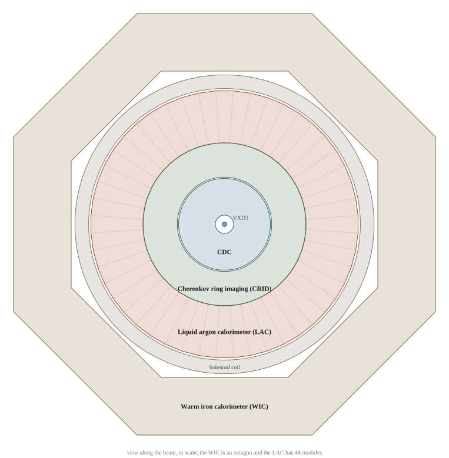
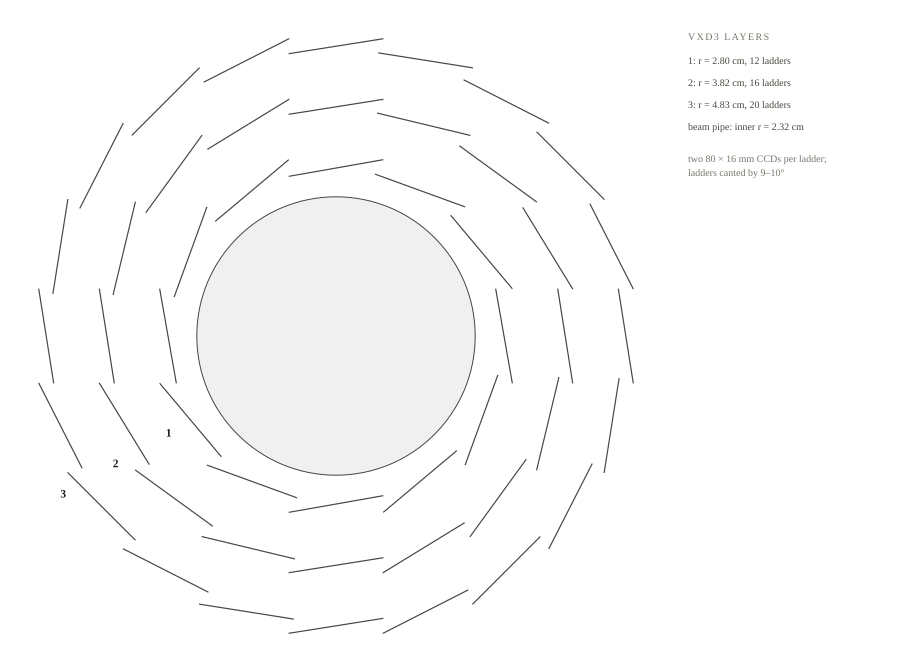

SLD was a general-purpose detector built around the interaction point of the SLC. From the
beam outwards it has a CCD vertex detector, a central drift chamber, a Cherenkov ring
imaging detector, a liquid argon calorimeter inside a 0.6 T solenoid, and an iron flux
return instrumented with streamer tubes as a hadron tail catcher and muon identifier.
This section describes it as it ran from 1996 to 1998, after the three-layer vertex
detector VXD3 replaced its predecessor.

## Layout and coordinates

SLD uses a right-handed frame with its origin at the interaction point, the z axis along
the positron beam, pointing north, and the y axis vertically up [@agnew1993vxd2]; the polar
angle θ is measured from +z and the azimuth φ from +x [@abe2005rbrc]. Figure 4.7
shows one quadrant of the detector in the plane that contains the beam, to scale, and
Figure 4.8 the barrel seen along the beam. Outlines without a published dimension are read
from SLAC's 1993 quadrant drawing of the detector [@drawing7282].

The same geometry, built in three dimensions, can be rotated, panned and zoomed below;
each subsystem can be hidden, and one quarter is cut away to show the inside.

<iframe src="../figures/sld-detector-3d.html" title="Interactive 3D model of the SLD detector" loading="lazy" style="width: 100%; aspect-ratio: 4 / 3; border: 1px solid var(--rule); border-radius: 4px;"></iframe>

Table 4.2 summarises the subsystems.

<!-- table:sld-subsystems -->
| Subsystem | Position | Coverage | Performance |
|---|---|---|---|
| VXD3 | 3 layers of CCDs at r = 28.0, 38.2, 48.3 mm | ≥ 3 hits for \|cos θ\| < 0.85, 2 hits to 0.90 | 3.8 µm per hit; impact parameter 7.8 µm (rφ), 9.7 µm (rz) at high momentum |
| CDC | r = 0.2–1.0 m, 2 m long | \|cos θ\| < 0.85 | 55–110 µm per hit; with VXD3 $\sigma(\pT)/\pT = 0.01 \oplus 0.0026\,\pT$ |
| CRID | barrel r ≈ 1.02–1.77 m; endcaps z = 1.24–1.96 m | barrel \|cos θ\| < 0.68 | Cherenkov angle 16 mrad (liquid), 4.5 mrad (gas) per photon |
| LAC | barrel r = 1.77–2.91 m; endcaps z = 2.21–3.61 m | 98% of 4π | 15%/√E (electromagnetic), 60%/√E (hadronic) |
| Coil | r ≈ 3.0 m, 6.5 m long | | 0.6 T |
| WIC | octagonal barrel and endcap doors, 14 iron plates | 99% of 4π | muon identification; 4.2 λ of iron |
| LUM | silicon–tungsten, 1.0 m from the IP | 28–68 mrad | small-angle Bhabha counting |

Table: The subsystems of SLD in 1996–1998 [@abe1997vxd3; @abe2000vxd3; @hildreth1995cdc; @abe2005rbrc; @abe1995ecrid; @abe1999hadrons; @axen1993lac; @breidenbach1986overview; @benvenuti1989wic; @berridge1992lum]. Energies in GeV, momenta in GeV/c.

## Tracking: VXD3 and the drift chambers

**VXD3** has 96 CCDs of 800 × 4000 pixels of 20 µm, 307 million pixels in all, mounted two
to a ladder on 48 ladders in three layers of 12, 16 and 20 at mean radii of 28.0, 38.2 and
48.3 mm (Figure 4.9) [@abe1997vxd3]. The ladders are canted by 9 to 10°
so that neighbours overlap in azimuth. Each ladder contributes 0.40% of a radiation length
at normal incidence, and the beam pipe inside it has an inner radius of 23.2 mm
[@abe1997vxd3]. A track from the interaction point crosses all three layers out
to |cos θ| = 0.85 and two out to 0.90, and the single-hit resolution is about 3.8 µm
[@abe2000vxd3]. With the drift chamber the impact-parameter resolution reaches 7.8 µm in
rφ and 9.7 µm in rz at high momentum and 34 µm in both at $\pT\sqrt{\sin\theta} = 1$ GeV/c
[@abe2005abac]. Its
predecessor VXD2, in use until 1995, had 480 CCDs on 60 ladders in four layers, the
outermost covering |cos θ| < 0.75, and a track from the interaction point crossed at least
two of its CCDs, 2.3 on average [@abe1996rb].

The **central drift chamber** is a cylinder from 0.2 to 1.0 m in radius, 2 m long, with
640 cells in 10 superlayers of 8 sense wires; four superlayers are axial and six have a
stereo angle of 41 mrad [@hildreth1995cdc; @abe1996rb]. Its gas is CO₂, argon and
isobutane (75:21:4) with a trace of water. The drift resolution is 55–110 µm, the
ionisation-loss resolution 6.4% for electrons from wide-angle Bhabha events, and the
chamber alone measures transverse momentum to
$(\delta\pT/\pT^2)^2 = 0.0050^2 + (0.010/\pT)^2$ [@hildreth1995cdc]. A track needs four
superlayers, which limits tracking to |cos θ| < 0.85 [@abe1997vxd3]. **Endcap drift
chambers** on each side, split into an inner and an outer chamber by the endcap CRID, were
designed to extend tracking further forward [@breidenbach1986overview].

## Particle identification: the CRID

The **Cherenkov ring imaging detector** identifies charged particles by the angle of their
Cherenkov light in two radiators [@abe1994crid]. In the barrel a track leaving the drift
chamber crosses 1 cm of liquid C₆F₁₄, whose light reaches one of 40 time-projection
chambers directly, and then about 40 cm of gas, a C₅F₁₂ and nitrogen mixture, whose light
one of 400 mirrors focuses back onto the chambers [@abe1999hadrons]. The chambers convert
the photons on TMAE in ethane and drift the electrons up to 1.2 m. The measured
resolution of the Cherenkov angle is 16 mrad per photon in the liquid and 4.5 mrad in the
gas, and pions, kaons and protons are separated from a few hundred MeV to tens of GeV
[@abe1999hadrons]. The barrel covers |cos θ| < 0.68. The endcap CRID has gas radiator
only, C₄F₁₀, in two vessels at |z| = 1.24 to 1.96 m covering polar angles of 10° to 35°
[@abe1995ecrid].

## Calorimetry and the magnet

The **liquid argon calorimeter** sits inside the coil, which spares the showers about two
thirds of an interaction length of uninstrumented material [@axen1993lac]. Its barrel
cryostat spans radii of 1.775 to 2.910 m, and two endcaps close it from 8° to 35° in polar
angle; together they cover 98% of the solid angle. The barrel has 48 modules in azimuth
and three along the beam. Electromagnetic modules use 2 mm lead plates and hadronic
modules 6 mm, with 2.75 mm argon gaps, read out in four depth sections: EM1 (6 X₀), EM2
(15 X₀), HAD1 and HAD2 (1 λ each), 2.8 λ in all. The towers are projective, 33 mrad in
azimuth in the electromagnetic sections and twice as large in the hadronic ones, with
32,448 towers in the barrel and 8,640 in the endcaps [@axen1993lac]. The measured energy
resolution is 15%/√E for electromagnetic and 60%/√E for hadronic showers
[@abe1999hadrons].

The **solenoid** is a room-temperature aluminium coil of about 6 m diameter, 6.5 m length
and 30 cm thickness, which gives a uniform 0.6 T [@breidenbach1986overview; @abe1999hadrons].
Its flux returns through the **warm iron calorimeter**, an octagonal barrel and two endcap
doors, each built of 14 iron plates 5 cm thick [@benvenuti1989wic] with limited streamer
tubes in the 3.2 cm gaps [@benvenuti1990calsys]. The tubes are read out by pads ganged
into projective towers that match the calorimeter, which measure the tail of hadron
showers, and by strips on a 1 cm pitch along the tubes, which track muons through the
iron [@benvenuti1990lst]. Its
70 cm of iron amount to about 4.2 interaction lengths, and it covers all but the holes
for the beam line, less than 1% of the solid angle [@benvenuti1989wic].

## Luminosity and an event

The **luminosity monitor** counts Bhabha events at small angles. Silicon–tungsten
calorimeters, one on each side of the interaction point with their front faces about 1 m
away, cover 28 to 68 mrad from the beam [@berridge1992lum]. A second, closer calorimeter
covered 68 to 190 mrad [@berridge1992lum] until it was removed to make room for VXD3
[@langston1996lum].

Figure 4.10 shows a hadronic Z decay recorded in 1997, drawn from its
mini-DST record. Two jets of tracks curve in the field, and the clusters they and the
photons of the jets leave in the barrel calorimeter line up behind them.

!!! summary "Key points"
    - SLD's frame has +z along the positron beam, pointing north; the 0.6 T solenoid
      encloses the vertex detector, drift chamber, CRID and liquid argon calorimeter.
    - VXD3 gave three hits out to |cos θ| = 0.85 and an impact-parameter resolution of
      about 8 µm in rφ and 10 µm in rz at high momentum, the basis of SLD's heavy-flavour
      tagging.
    - The CRID identifies hadrons with liquid and gas radiators; the LAC measures
      electromagnetic showers to 15%/√E; the iron identifies muons.
    - Dimensions in the figures come from the subsystem papers where they exist and from
      the 1993 quadrant drawing otherwise.

## Further reading

The subsystem papers [@abe1997vxd3; @hildreth1995cdc; @abe1994crid; @axen1993lac;
@benvenuti1989wic] describe each detector in full, and the design report
[@sld1984design] gives the original concept, which changed in several places before the
detector was built.
