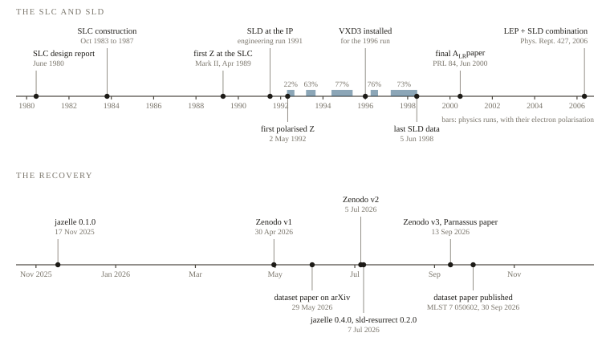

SLD, the SLAC Large Detector, recorded electron–positron collisions at the Z pole at the
SLAC Linear Collider from 1992 to 1998. Its electron beam was polarised, with a helicity
chosen at random for every bunch, and its vertex detector was built of CCDs. With about
600,000 Z decays, far fewer than the LEP experiments recorded, it gave the determination of
the weak mixing angle with the smallest uncertainty of all Z-pole measurements, and
measured the asymmetry parameters of the b and c quarks directly
[@schael2006zpole; @abe2000alr].

Figure 4.1 places the experiment in time. The collider was designed in
1980 and built from 1983 to 1987 [@slac1980cdr; @phinney2000slc]. SLD replaced the Mark II
detector at the interaction point in 1991 and saw its first Z from a polarised beam on
2 May 1992 [@sldhistory]. The polarisation rose from 22% in 1992 [@abe1993alr] to between
73% and 77% from 1994 on [@schael2006zpole], the vertex detector VXD3 arrived in 1996 [@abe1997vxd3], and the last data
were taken on 5 June 1998 [@sldhistory].

The reconstructed 1996–1998 data survive as mini-DST files, which were recovered,
validated and released in 2025–2026 together with simulated events and a reader that
converts them to modern formats [@cheng2026aiready; @zenodo; @jazellereader; @lo2026parnassus].
This chapter is the background to those files. It follows the data from the accelerator
to the bytes:

- [the SLC and its polarised beam](slc.md), with the polarimeter and the beam energy;
- [the physics of the Z pole](physics.md) with a polarised beam;
- [the detector](detector.md), subsystem by subsystem;
- [simulation and processing](simulation.md), from the generator to the mini-DST;
- [the mini-DST format](minidst.md): records, families, ids and numbers;
- the banks, field by field: [reconstruction](banks-reconstruction.md) and
  [event, beam and truth](banks-event-truth.md);
- [how the undocumented banks were decoded](decoding.md);
- [simulated events and the background overlay](mc-records.md);
- [the measurements and the data products](measurements.md).

!!! summary "Key points"
    - SLD ran at the SLC from 1992 to 1998 with a longitudinally polarised electron beam,
      recording about 600,000 Z decays.
    - The 1996–1998 reconstructed data survive as mini-DSTs, recovered and released in
      2026.
    - The following sections describe the accelerator, the physics, the detector, the
      simulation and the format of those files.
