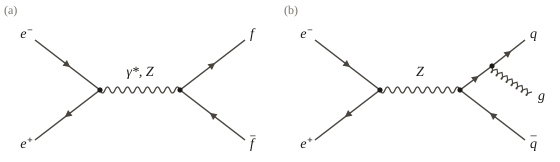
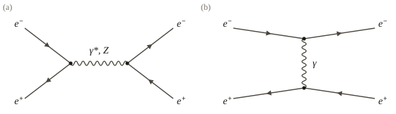
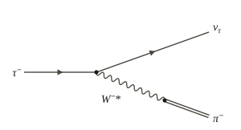

At a centre-of-mass energy near 91.2 GeV, electron–positron annihilation is dominated by
the production of a real Z boson, which decays to a fermion–antifermion pair. How often
the Z decays to each fermion and in which direction the fermion goes are fixed by the Z's
couplings, and the ratio of the couplings, which sets the angular distribution and the
asymmetries, depends on one parameter of the electroweak theory, the effective weak mixing
angle. SLD measured that angle, and the asymmetry parameters of the leptons and heavy
quarks, with an electron beam whose helicity it chose at random for every bunch.
This section sets out the quantities and their relations. The measurements themselves
are in the [last section of this chapter](measurements.md).

## The Z and its couplings

Figure 4.4 shows the annihilation. At the pole the photon contributes little, through
pure photon exchange and its interference with the Z, and initial-state radiation lowers
the effective collision energy. The analyses correct for all three. The Z couples to a
fermion f through an effective vector and axial-vector coupling [@schael2006zpole],

$$
g_{Vf} = \sqrt{\rho_f}\,\left(T_3^f - 2Q_f\sin^2\theta_{\mathrm{eff}}^f\right),\qquad
g_{Af} = \sqrt{\rho_f}\,T_3^f,
\label{eq:sld-couplings}
$$

where $T_3^f$ is the third component of weak isospin, $Q_f$ the electric charge,
$\sin^2\theta_{\mathrm{eff}}^f$ the effective mixing angle of that fermion and
$\rho_f \approx 1$ the effective normalisation of the coupling, which absorbs radiative
corrections to its overall strength. The asymmetries below depend only on the ratio of
the two couplings, through the **asymmetry parameter**

$$
\mathcal{A}_f = \frac{2\,g_{Vf}\,g_{Af}}{g_{Vf}^2 + g_{Af}^2}
= \frac{2\,g_{Vf}/g_{Af}}{1 + (g_{Vf}/g_{Af})^2},\qquad
\frac{g_{Vf}}{g_{Af}} = 1 - 4|Q_f|\sin^2\theta_{\mathrm{eff}}^f.
\label{eq:sld-af}
$$

For charged leptons, $|Q| = 1$ and $\sin^2\theta_{\mathrm{eff}}^{\mathrm{lept}} \approx
0.23$, so $g_V/g_A$ is small and $\mathcal{A}_\ell \approx 0.15$ changes about eight
times faster than the mixing angle [@schael2006zpole]:

$$
\mathcal{A}_e = \frac{2\,(1 - 4\sin^2\theta_{\mathrm{eff}}^{\mathrm{lept}})}
{1 + (1 - 4\sin^2\theta_{\mathrm{eff}}^{\mathrm{lept}})^2},\qquad
\delta\mathcal{A}_e \approx -8\,\delta\sin^2\theta_{\mathrm{eff}}^{\mathrm{lept}}.
\label{eq:sld-ae}
$$

For the b quark, with $|Q| = 1/3$, the same mixing angle gives $\mathcal{A}_b \approx
0.935$, close to its maximum and almost insensitive to the angle [@schael2006zpole].

## Asymmetries with a polarised beam

With an electron beam of longitudinal polarisation $P_e$, positive for right-handed
helicity, and an unpolarised positron beam, the Born-level angular distribution of
$e^+e^- \to Z \to f\bar f$ is [@schael2006zpole]

$$
\frac{\mathrm{d}\sigma_f}{\mathrm{d}\cos\theta} = \frac{3}{8}\,\sigma_f
\left[(1 - P_e\mathcal{A}_e)(1 + \cos^2\theta) + 2(\mathcal{A}_e - P_e)\,\mathcal{A}_f\cos\theta\right],
\label{eq:sld-dsigma}
$$

with $\sigma_f$ the total cross section for unpolarised beams and $\theta$ the angle of the
outgoing fermion to the electron beam. Two asymmetries follow.

!!! definition "Left-right asymmetry"
    The asymmetry of the cross sections for left- and right-handed electron beams,
    normalised by the luminosity-weighted magnitude of the beam polarisation. SLD
    measures it by counting Z decays produced with each helicity:

    $$
    A_{LR} = \frac{1}{\langle |P_e|\rangle}\,\frac{N_L - N_R}{N_L + N_R}.
    \label{eq:sld-alr}
    $$

Integrating equation $\eqref{eq:sld-dsigma}$ over the angle leaves only the first term, so
the left-right asymmetry measures $\mathcal{A}_e$ alone, whatever the final state.
After a correction of about 2% of its value for initial-state radiation and photon–Z
interference, the asymmetry at the pole equals it [@schael2006zpole]:
$A_{LR}^0 = \mathcal{A}_e$. The second term is a forward–backward asymmetry. Without
polarisation it gives $A_{FB}^{0,f} = \tfrac{3}{4}\mathcal{A}_e\mathcal{A}_f$, which mixes
the couplings of the initial and the final state. With polarisation, the left-right
forward–backward asymmetry, or polarised forward–backward asymmetry, formed from the
forward ($\cos\theta > 0$) and backward cross sections $\sigma_F$ and $\sigma_B$ with left-
and right-handed beams, isolates the final state [@schael2006zpole; @abe2001lepton]:

$$
\tilde A_{FB}^{f} = \frac{(\sigma_F - \sigma_B)_L - (\sigma_F - \sigma_B)_R}
{(\sigma_F + \sigma_B)_L + (\sigma_F + \sigma_B)_R} = \frac{3}{4}\,|P_e|\,\mathcal{A}_f.
\label{eq:sld-alrfb}
$$

!!! remark "What polarisation buys"
    The left-right asymmetry needs neither the luminosity nor the detector acceptance,
    only the beam polarisation, and no QCD correction [@abe2000alr; @schael2006zpole].
    In principle any final state except electron–positron pairs, whose asymmetry the
    t-channel photon exchange dilutes, would serve. The SLD measurement counted hadronic
    Z decays, and its selection removed almost all τ and μ pairs
    [@abe2000alr; @schael2006zpole]. For the final-state couplings, the polarised
    forward–backward asymmetry of equation $\eqref{eq:sld-alrfb}$ is larger than the
    unpolarised one by $|P_e|/\mathcal{A}_e$; at $|P_e| = 0.75$ a polarised sample has the statistical power
    of an unpolarised sample $(0.75/0.15)^2 = 25$ times larger [@abe2001lepton].

## Heavy quarks and leptons

The partial widths of the Z to heavy quarks are measured as fractions of the hadronic
width [@schael2006zpole],

$$
R_b^0 = \frac{\Gamma_{b\bar b}}{\Gamma_{\mathrm{had}}},\qquad
R_c^0 = \frac{\Gamma_{c\bar c}}{\Gamma_{\mathrm{had}}},
\label{eq:sld-rq}
$$

and their asymmetry parameters $\mathcal{A}_b$ and $\mathcal{A}_c$ through equation
$\eqref{eq:sld-alrfb}$ applied to tagged b and c events. Both measurements lean on the
vertex detector: b and c hadrons decay at vertices displaced from the primary one, and the
tags are built from the tracks and the mass of those secondary vertices
[@abe2005rbrc; @abe2005abac].

For the leptons, every lepton-pair final state measures $\mathcal{A}_e$ through the
left-right asymmetry and its own $\mathcal{A}_\ell$ through equation
$\eqref{eq:sld-alrfb}$, in an event-by-event likelihood fit [@abe2001lepton]. In electron
pairs the final-state asymmetry is $\mathcal{A}_e$ itself, and Bhabha scattering, in which
the photon is exchanged in the t-channel as well (Figure 4.5), adds terms that the fit
includes. The Bhabha rate at small angles is large and calculable, which
is why the luminosity monitors count small-angle Bhabha events. The τ is the one lepton
that decays inside the detector, through a W, and the spin of a τ shapes the momentum of
its decay products (Figure 4.6). The high beam polarisation makes the τ polarisation
large and dependent on the polar angle, so the τ selection, through its cut on the event
mass, changes the polar-angle dependence of the efficiency. This shifts the
fitted $\mathcal{A}_\tau$ by about $+0.018$, which the analysis subtracts. The left-right
efficiencies, and with them $\mathcal{A}_e$ from τ pairs, are not affected
[@abe2001lepton].

!!! summary "Key points"
    - The asymmetries depend on the ratio of the Z couplings through $\mathcal{A}_f$, and
      that ratio depends only on the effective mixing angle.
    - With a polarised electron beam the left-right asymmetry measures $\mathcal{A}_e$
      from the helicity counts and the beam polarisation alone, and it changes eight times
      faster than the mixing angle.
    - The left-right forward–backward asymmetry measures each final state's
      $\mathcal{A}_f$ directly, with the statistics of a 25 times larger unpolarised
      sample at 75% polarisation.
    - $R_b$, $R_c$, $\mathcal{A}_b$ and $\mathcal{A}_c$ rest on vertex tagging.

## Further reading

The joint LEP and SLD report [@schael2006zpole] derives every relation above and gives
the corrections that turn measured asymmetries into pole quantities. The electroweak
review of the Particle Data Group [@erler2024pdg] uses the opposite sign of $P_e$; the
relations here follow the SLD convention.
