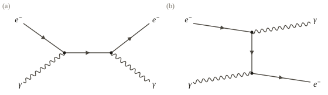

The SLAC Linear Collider was the first electron–positron linear collider
[@schael2006zpole]. Instead of storing beams in a ring, it collided a single bunch of
electrons with a single bunch of positrons once per pulse, 120 times a second, after
accelerating both in the 3 km SLAC linac and bending them through two arcs. The colliding electron
bunch left the source polarised, and its spin was rotated during transport so that it
reached the interaction point longitudinally polarised [@schael2006zpole]. The SLC delivered
an electron beam whose helicity was chosen at random for every pulse. This section describes the machine, the
polarised source and the two measurements the physics depends on: the polarisation and the
beam energy.

## The collider

Figure 4.2 traces a pulse. Electrons from the polarised source are
damped in a ring at 1.19 GeV and injected into the linac; a second electron bunch,
accelerated to 30 GeV, strikes a target, and the positrons it produces are collected,
returned to the start of the linac and damped in their own ring
[@woods1996polbeam; @schael2006zpole]. Both beams reach 46.6 GeV at the end of the linac,
are separated into two arcs of about 1 km [@sldcollider], lose about 1 GeV to synchrotron
radiation and collide at 45.6 GeV per beam, close to the Z pole [@woods1996polbeam]. The
final focus squeezes them to spots of about 1.5 µm by 0.7 µm, flat since 1993
[@schael2006zpole; @phinney2000slc].

The machine took ten years to approach its design luminosity [@phinney2000slc]. That design
was not the conceptual design of 1980 but a later one, and Table 4.1 compares both with the
final run of 1997–98, when the luminosity peaked at about $3\times10^{30}$ cm⁻² s⁻¹, or
300 Z decays an hour, half the later design value [@phinney2000slc; @assmann2000endgame].

<!-- table:slc-parameters -->
| Parameter | 1980 design | Later design | 1997–98 |
|---|---|---|---|
| Repetition rate | 180 Hz | 180 Hz | 120 Hz |
| Particles per bunch | $5\times10^{10}$ | $7.2\times10^{10}$ | $4.2\times10^{10}$ |
| Spot size at the IP | 2 µm × 2 µm | 1.65 µm × 1.65 µm | 1.4 µm × 0.7 µm |
| Peak luminosity | $10^{30}$ cm⁻² s⁻¹ | $6\times10^{30}$ cm⁻² s⁻¹ | $3\times10^{30}$ cm⁻² s⁻¹ |
| Electron polarisation | | | 73% |

Table: SLC parameters in the 1980 conceptual design [@slac1980cdr], in the later design and in the final run [@assmann2000endgame; @phinney2000slc; @abe2000alr]. The 1980 design luminosity was quoted for 50 GeV beams.

## The polarised source

Polarised electrons came from a GaAs photocathode lit by circularly polarised light from a
titanium–sapphire laser [@schael2006zpole]. A Pockels cell set the sense of the circular
polarisation, and so the electron helicity, for every pulse from a pseudo-random sequence
at 120 Hz [@woods1996polbeam]. The random choice is what makes the left-right asymmetry a
counting measurement: the two helicities share every beam condition, and a feedback kept
the helicity dependence of the beam current below $10^{-4}$ [@schael2006zpole].

!!! definition "Electron helicity of a pulse"
    The sign of the longitudinal polarisation of the electron bunch, chosen at random at
    the source and recorded with every event. Together with the polarimeter measurement it
    gives each event its signed beam polarisation.

A bulk GaAs cathode can give at most 50% polarisation [@sldpes]. The 1992 run, with bulk GaAs,
reached $(22.4\pm0.6)\%$ [@abe1993alr]; a strained GaAs cathode raised it to
$(63.0\pm1.1)\%$ in 1993 [@abe1994alr], and a thinner strained layer on GaAsP to
$(77.23\pm0.52)\%$ in 1994–95 [@abe1997alr; @woods1996polbeam]. The 1996 and 1997–98
runs, with different cathodes, averaged $(76.16\pm0.40)\%$ and $(72.92\pm0.38)\%$
[@abe2000alr]. Between the source and the interaction point, a solenoid in the transfer
line to the damping ring turned the spin vertical for storage, and it stayed vertical
along the linac. From 1993 two vertical orbit bumps in the electron arc turned it
longitudinal at the collision; in 1992 the spin-rotator solenoids after the ring and in the
linac had done this [@woods1996polbeam]. The positrons were unpolarised: a dedicated measurement
in 1998 found $(-0.02\pm0.07)\%$ [@abe2000alr].

## The Compton polarimeter

About 30 m after the interaction point, the electron beam crossed a pulsed laser beam:
532 nm light of 2.33 eV, 8 ns pulses at about 17 Hz [@schael2006zpole]. Of order a
thousand electrons per pulse Compton-scatter (Figure 4.3); a pair of dipoles
sweeps them out of the beam into a nine-channel gas Cherenkov detector that covers
17 to 30 GeV [@schael2006zpole; @abe2000alr]. The rate in each channel depends on whether
the electron and photon helicities are parallel or opposite, and the asymmetry between the
two is the product of the electron polarisation, the laser polarisation and the Compton
analysing power at that energy. The analysing power reaches its maximum of 0.748 at the
kinematic edge of 17.4 GeV and crosses zero at 25.2 GeV
[@schael2006zpole; @woods1996polarimeter].

A three-minute run measured the polarisation to about 1% statistically
[@schael2006zpole]. The relative systematic uncertainty fell from 2.7% in 1992 to 0.50% in
1996–98, where the calibration of the analysing power was the largest term, checked from
1996 by two independent photon detectors [@abe2000alr; @schael2006zpole]. Every event
carries the helicity of its pulse and the polarisation of the nearest polarimeter
measurement [@sldpolarimetry]. In the mini-DST, PHBM stores the two as one signed
polarisation. A further PHBM word, decoded from the data and not yet released, holds the
time to that measurement; four data files of 1998 carry a fixed average polarisation of 73%
in place of a measurement [@banklab].

## The beam energy

A spectrometer in each extraction line, about 150 m downstream, measured the beam energy
from the bend of a precisely known dipole [@kent1989energy]. Small magnets before and
after it made stripes of synchrotron radiation, recorded on phosphor screens and on arrays
of 75 µm copper wires, and the separation of the stripes gave the deflection. Each beam energy was expected to be known
to 20 MeV [@kent1989energy]. An error of 80 MeV on the centre-of-mass energy changes the
pole asymmetry by 1%, through the energy dependence of photon–Z interference
[@schael2006zpole]. In 1998 a scan of the Z resonance calibrated the spectrometers against
the Z mass and found an offset of −46 MeV; the mean energy of 1997–98 became
$91.237\pm0.029$ GeV, against $91.26\pm0.03$ GeV in 1996 [@schael2006zpole; @abe2000alr].

!!! summary "Key points"
    - The SLC collided single bunches of 45.6 GeV electrons and positrons at 120 Hz after
      accelerating both in the 3 km SLAC linac.
    - The electron helicity was chosen at random for every pulse; the polarisation rose
      from 22% in 1992 to between 73% and 77% from 1994.
    - A Compton polarimeter 30 m downstream measured the polarisation to 0.5% relative in
      1996–98; energy spectrometers, calibrated for 1997–98 by a Z-pole scan, fixed the
      mean centre-of-mass energy to about 30 MeV.

## Further reading

The joint LEP and SLD report [@schael2006zpole] describes the SLC, the polarimetry and the
energy calibration in detail, and Phinney [@phinney2000slc] reviews the machine's history.
