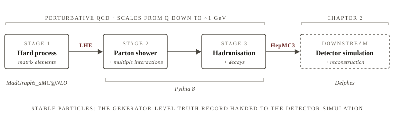

## The simulation chain

A high-energy collision, whether of protons at the LHC, of electrons and
positrons at a lepton collider, or of an electron and a proton, involves
physics on every scale from the hard scattering at the collision energy down
to the formation of hadrons at about 1 GeV. No single calculation covers that
range. Event generators instead exploit the factorisation of QCD into a chain
of stages, each handled by a method suited to its scale [@buckley2011]. The
hard process is computed from matrix elements at fixed order in perturbation
theory. The parton shower dresses it with soft and collinear radiation down to
a cutoff of order 1 GeV. Hadronisation turns the resulting partons into
hadrons with a phenomenological model, and unstable hadrons are decayed. Only
then is the event handed to a detector simulation such as Delphes [@delphes],
the subject of Chapter 2.

The chain is the same for every collider; what differs is the initial state.
With hadron beams the colliding partons carry unknown momentum fractions drawn
from parton distribution functions, and the beam remnants interact among
themselves, so the generator must also model multiple parton interactions and
the underlying event. With lepton beams the initial state is known, up to
initial-state radiation and beamstrahlung, and those stages fall away. The
examples in this chapter use proton–proton collisions, the case with the most
moving parts; the lepton-collider setting is the same chain with the
hadron-specific pieces switched off.



Figure 1.1 shows the chain used throughout this book. Its stages are separable
because they communicate through standard event records: the Les Houches Event
(LHE) format at parton level and HepMC3 at particle level
(Section 1.6). Table 1.1 summarises what each stage computes and what it
writes.

| Stage | Physics | Method | Program | Output |
|---|---|---|---|---|
| Hard process | $2 \to n$ scattering at scale $Q$ | Fixed-order matrix elements, phase-space integration | MadGraph5_aMC@NLO | LHE |
| Parton shower | Soft and collinear QCD/QED radiation; multiple parton interactions for hadron beams | Sudakov-ordered Markov chain | Pythia 8 | in memory |
| Hadronisation and decays | Confinement, hadron decays | Lund string model, decay tables | Pythia 8 | HepMC3 |
| Detector response | Material interactions, resolution, efficiencies | Parametrised (fast) or Geant4 (full) | Delphes, Geant4 | ROOT |

Table: The stages of event generation. The last row belongs to Chapter 2 and
is listed only to show where the generator record ends.

## The programs

Four programs appear throughout this book. Each occupies one stage of
Figure 1.1, each is configured through plain-text files, and each has a
reference publication that should be cited whenever the program is used.

### MadGraph5_aMC@NLO

MadGraph5_aMC@NLO [@alwall2014] is a matrix-element generator. Given a model
and a process written in a one-line syntax (`generate p p > t t~`), it
enumerates the Feynman diagrams, writes and compiles code for the squared
amplitude, integrates over phase space, and produces unweighted parton-level
events in the LHE format. It works at leading order for any process in any
model, and at next-to-leading order in QCD for Standard Model and many
beyond-Standard-Model processes, with the MC@NLO method for matching to a
shower. The model is supplied as a UFO package (Section 1.3.3); the run is
controlled by a handful of *cards* (Section 1.3.2). MadGraph also bundles
MadSpin, which decays heavy resonances after generation (Section 1.3.4), and
can drive Pythia 8 directly for the shower.

### Pythia 8

Pythia 8 [@bierlich2022] is a general-purpose event generator: it contains its
own leading-order matrix elements for a large library of processes, but in the
chain of Figure 1.1 it is used for everything *after* the hard process. It
reads the LHE events, adds initial- and final-state parton showers and, for
hadron beams, multiple parton interactions and beam remnants, hadronises the
partons with the Lund string model, and decays the unstable hadrons. Pythia is a C++ library; a
main program creates a `Pythia` object, feeds it settings, and asks for events
one at a time. Its behaviour is controlled entirely by *settings*, `Key =
value` pairs with documented defaults, usually collected in a command file
(Section 1.4.2).

### Delphes

Delphes [@delphes] is a fast detector simulation. It takes the stable
particles of a generator-level event and applies a parametrised detector
response: charged particles are propagated through a magnetic field, tracks
and calorimeter deposits are smeared and accepted with efficiency functions,
particle-flow candidates are built, and jets, leptons, photons and missing
transverse momentum are reconstructed. The detector model is a *card*, a Tcl
file that lists the modules to run and sets their parameters; the Delphes
distribution ships cards approximating ATLAS and CMS as well as detectors
proposed for future electron–positron and hadron colliders. The output is a ROOT tree with one branch per reconstructed
collection. Chapter 2 treats the card and the output in detail.

### Geant4

Geant4 [@geant4; @geant4b] is a toolkit for simulating the passage of
particles through matter. It is the foundation of the experiments' *full*
simulations: a detailed geometry of the detector is built from Geant4 volumes
and materials, a *physics list* selects the electromagnetic and hadronic
interaction models, and every particle is tracked step by step through the
material, producing the energy deposits that a digitisation step turns into
simulated electronics signals. The result is as faithful as the geometry and
physics models allow, and costs minutes of CPU per event against milliseconds
for Delphes. Geant4 does not appear in the chain used in this book, but it is
the reference against which any fast simulation is judged, and its particle
transport sets the conventions, such as which particles are "stable", that the
fast simulation inherits.

## Hard process and matrix elements

### The master formula

The cross section for a hard process is the cross section for the colliding
partons, weighted by the probability of finding those partons in the beams.
For a hadron collider this factorises into parton distribution functions
(PDFs) and a partonic cross section,

$$
\sigma = \sum_{a,b} \int_0^1 \dd x_a \, \dd x_b \;
  f_a(x_a, \mu_\mathrm{F}^2)\, f_b(x_b, \mu_\mathrm{F}^2)\;
  \hat\sigma_{ab}\!\left(x_a x_b s;\, \mu_\mathrm{F}^2, \mu_\mathrm{R}^2\right),
\label{eq:xsec}
$$

where $f_a(x, \mu_\mathrm{F}^2)$ is the probability density of finding parton
$a$ with momentum fraction $x$ in the proton, probed at factorisation scale
$\mu_\mathrm{F}$, and $\hat\sigma_{ab}$ is the partonic cross section evaluated
at renormalisation scale $\mu_\mathrm{R}$. The partonic cross section is a
phase-space integral over the squared matrix element,

$$
\hat\sigma_{ab} = \frac{1}{2\hat s} \int \dd\Phi_n \;
  \overline{\left|\mathcal{M}_{ab \to n}\right|^2},
\label{eq:partonic}
$$

with the bar denoting the average over initial and sum over final spins and
colours. For lepton beams the parton distributions in $\eqref{eq:xsec}$
collapse to the beam particles themselves, broadened only by initial-state
radiation and beamstrahlung, and the collider cross section is
$\eqref{eq:partonic}$ evaluated at the beam energy. A matrix-element
generator evaluates
$\eqref{eq:xsec}$–$\eqref{eq:partonic}$ numerically and, crucially, *unweights*
the integrand so that each generated phase-space point occurs with a
probability proportional to its differential cross section. The result is a
set of events with equal weights that can be treated like data. MadEvent does
this channel by channel, each channel contributing events in proportion to its
cross section, and a run reaches the number requested only when every channel
converges. A channel whose integrand is not finite never does: the run ends
with fewer events than asked for and says so in its log. The cause is almost
always a divergence left uncut, light partons in the final state without a
transverse-momentum, separation or invariant-mass cut, or a particle that can
decay but was given zero width and diverges wherever it appears as an
$s$-channel resonance. The per-channel luminosities in the log point at the
channel at fault, and the cure is a cut in the run card, not a larger request.

### The MadGraph cards

MadGraph is driven by a small set of plain-text cards (Table 1.2). Every
physics choice lives in one of them, so a generation is reproduced by
reproducing the cards, and the program copies the cards it actually used into
the banner of the LHE file it writes.

| Card | Controls | Typical contents |
|---|---|---|
| `proc_card_mg5.dat` | The model and the process | `import model sm`, `generate p p > t t~` |
| `run_card.dat` | Beams, cuts, PDFs, number of events, matching scale, seed | `ebeam1`, `ptj`, `pdlabel`, `nevents`, `xqcut`, `iseed` |
| `param_card.dat` | Model parameters: masses, widths, couplings | `MT`, `WT`, `MH` |
| `madspin_card.dat` | Decays of heavy resonances with spin correlations | `decay t > w+ b, w+ > all all` |
| `pythia8_card.dat` | Settings forwarded to Pythia when MadGraph runs the shower | matching settings, `Main:numberOfEvents` |
| `delphes_card.dat` | The detector model when MadGraph runs Delphes | a copy of a Delphes card |

Table: The MadGraph5_aMC@NLO cards. The last two are only used when the shower
and detector simulation are launched from inside MadGraph.

The **process card** is a script in MadGraph's command language. The example
below is the complete input for top-pair production in the Standard Model.

```text
import model sm                 # the UFO model; restrictions as sm-no_b_mass
define p = g u c d s u~ c~ d~ s~  # the proton as a multiparticle (4 flavours + gluon)
define j = p                    # a jet is any of the same partons
generate p p > t t~             # the process; "add process" appends another
output pp_ttbar                 # write the process directory
```

Each line is a command. `import model` loads a UFO model from MadGraph's
`models/` directory or from a path; `-` after the name selects a restriction
card, so `sm-no_b_mass` is the Standard Model with the $b$ quark massless.
`define` groups particles under a label; the defaults already define `p` and
`j` as shown, and redefining them to include the $b$ quark gives a five-flavour
scheme. `generate` states the process; a second process is appended with
`add process`, and `@n` after the process assigns a label used in the LHE
subprocess id. `output` writes the directory with the compiled matrix elements,
and `launch` (interactive or in the same script) runs it.

The **run card** holds everything about the collision and the generation that
is not part of the model. Its format is `value = name ! comment`, one entry
per line; the comments are MadGraph's own and the ones below are shortened.

```text
  10000     = nevents  ! number of unweighted events requested
  0         = iseed    ! random seed; 0 = chosen by the program, recorded in the banner
  1         = lpp1     ! beam 1: 1 = proton, -1 = antiproton, 0 = no PDF (lepton)
  1         = lpp2     ! beam 2
  6500.0    = ebeam1   ! beam 1 energy in GeV
  6500.0    = ebeam2   ! beam 2 energy in GeV
  lhapdf    = pdlabel  ! PDF: a built-in set name, or lhapdf
  303600    = lhaid    ! LHAPDF id when pdlabel = lhapdf (303600 = NNPDF31_nnlo_as_0118)
  -1.0      = scale    ! fixed factorisation scale; -1 = dynamical (dynamical_scale_choice)
  0         = ickkw    ! matching: 0 = none, 1 = MLM (Section 1.5)
  0.0       = xqcut    ! parton-level matching cut in GeV; 0 when ickkw = 0
  20.0      = ptj      ! minimum jet transverse momentum in GeV
  5.0       = etaj     ! maximum jet |eta|; -1 = no cut
  0.4       = drjj     ! minimum Delta R between jets
  True      = use_syst ! store scale and PDF variation weights in the event
```

`nevents` and `iseed` define the run; `nevents` is a request, and the number of
events the run wrote is read back from the banner (Section 1.6.1). `lpp` and
`ebeam` set the beams; `pdlabel`
and `lhaid` the PDF set, which must be the same one named in the shower and in
any cross-section normalisation later. `scale` and its companions fix or
delegate the renormalisation and factorisation scales of
$\eqref{eq:xsec}$. `ickkw` and `xqcut` switch on matrix-element matching; they
are explained in Section 1.5. The cuts `ptj`, `etaj` and `drjj` are
*generation cuts*: they define the phase space the sample covers, and no
analysis cut can recover a region they excluded. With matching enabled the
parton-level cuts are superseded by `xqcut`, and MadGraph adjusts them itself.
`use_syst` stores the weights for scale and PDF variations, which is cheap and
saves regenerating the sample for a systematic uncertainty.

The **parameter card** follows the SUSY Les Houches Accord layout
[@skands2004]: blocks of numbered parameters, with `DECAY` entries for widths.
Only the lines a Standard Model top-pair sample would usually touch are shown.

```text
Block mass
    5 4.700000e+00 # MB    b-quark mass (if the model has a massive b)
    6 1.730000e+02 # MT    top mass
   23 9.118800e+01 # MZ    Z mass
   25 1.250000e+02 # MH    Higgs mass
Block sminputs
    1 1.325070e+02 # aEWM1 1/alpha_EM at the Z mass
    2 1.166390e-05 # Gf    Fermi constant
    3 1.180000e-01 # aS    alpha_s at the Z mass
DECAY  6 1.491500e+00 # WT   top width
DECAY 23 2.441404e+00 # WZ   Z width
DECAY 24 2.047600e+00 # WW   W width
DECAY 25 6.382339e-03 # WH   Higgs width
```

Each `Block` groups parameters; the integer is the parameter's index (for
`mass`, the PDG id) and the comment names the UFO parameter. `DECAY <pdg>
<width>` sets the total width used in propagators and, if the resonance is
decayed by MadGraph, in the branching fractions. A width that is inconsistent
with the masses and couplings in the same card is a common and silent error;
`compute_widths` recalculates them inside MadGraph.

### UFO models

!!! definition "UFO model"
    A UFO (Universal FeynRules Output) model [@degrande2012] is a Python
    package describing a Lagrangian's particles, parameters, vertices and
    couplings in a form any matrix-element generator can read. It is
    generated from the Lagrangian by FeynRules and is the sole input a
    generator needs to compute any process in the model. A *restriction card*
    is a parameter card in which some parameters are set to zero or to equal
    values; importing `model-restriction` applies it at import time, removing
    the corresponding vertices. The restricted model is therefore not a new
    UFO but the base UFO plus a restriction, and both must be recorded.

The Standard Model ships with MadGraph as `sm`, with restrictions such as
`sm-no_b_mass` and `sm-ckm`. A model for new physics is a directory dropped
into `models/` or imported by path, and its provenance (where it was
downloaded, which version) belongs in the sample's documentation as much as
the cards do.

### MadSpin

!!! definition "MadSpin"
    MadSpin [@artoisenet2013] decays heavy resonances in already-generated
    LHE events while preserving spin correlations and finite-width effects.
    For each event it evaluates the full production-and-decay matrix element,
    samples the decay kinematics according to it, and writes a new LHE file in
    which the resonances have been replaced by their decay products. It works
    within the narrow-width approximation, so it is appropriate for $t$, $W$,
    $Z$ and $H$ but not for broad resonances or interference with
    non-resonant diagrams.

A shower program can also decay resonances, from a decay table, but it does so
one particle at a time and isotropically in the resonance rest frame, which
loses the correlations between, for example, the two top decays in a $t\bar t$
event. The **MadSpin card** lists the decay chains and a few options.

```text
set Nevents_for_max_weight 250   # events used to estimate the max. weight per channel
set BW_cut 15                    # allowed off-shellness, in units of the resonance width
set spinmode full                # full (default): spin correlations + off-shell effects
decay t  > w+ b,  w+ > all all   # the chain; "all all" sums over every W decay
decay t~ > w- b~, w- > all all
launch
```

`set` options tune the unweighting; the defaults are suitable for most
samples, and `BW_cut` is the one to check when a resonance's lineshape matters.
`decay` lines state each chain in MadGraph's process syntax, with nested
decays separated by commas; particles not mentioned are left undecayed.
`launch` runs the decay; the output is a second LHE file next to the first,
with the decayed particles given status 2 and their products status 1. The
events stay unweighted and their number is normally unchanged; what changes is
the cross section, which MadSpin multiplies by the branching ratio of the
requested chains and writes into the new banner. When the subprocesses of a
run decay with slightly different total branching ratios, MadSpin drops a few
events so that each resonance keeps its correct share, and its log reports the
number written against the number read. Setting the widths and branching
ratios in the parameter card, instead of leaving them to the automatic width
calculation, removes the mismatch.

!!! recipe "A minimal MadGraph run"
    The following script generates, decays and showers top-pair production in
    one go. Settings in the `launch` block override the cards.

    ```text
    import model sm
    generate p p > t t~
    output pp_ttbar
    launch pp_ttbar
      madspin=ON                  # decay with MadSpin after generation
      shower=Pythia8              # run the bundled Pythia 8 interface
      set nevents 10000
      set iseed 0
      set ebeam1 6500
      set ebeam2 6500
      set decay t > w+ b, w+ > all all
      set decay t~ > w- b~, w- > all all
    ```

    The process directory then holds the cards actually used under `Cards/`
    and, after the run, `Events/run_01/` with `unweighted_events.lhe.gz`
    (before MadSpin), `*_decayed_1/` (after it) and the showered output.
    The banner inside the LHE file embeds every card verbatim; keep it, as it
    is the authoritative record of the run.

## Parton shower and hadronisation

### The shower

A fixed-order matrix element describes a handful of well-separated partons.
Real events contain many more, produced by soft and collinear emissions that
the fixed-order calculation treats only inclusively. The parton shower
resums these emissions to all orders in the soft and collinear limits. It is
formulated as a Markov chain in an evolution variable $t$ (a virtuality, a
transverse momentum or an angle), in which the probability that a parton
evolves from scale $t_1$ down to $t_2$ *without* branching is the Sudakov
form factor

$$
\Delta(t_1, t_2) = \exp\!\left[
  -\int_{t_2}^{t_1} \frac{\dd t}{t} \int \dd z\,
  \frac{\alpha_\mathrm{s}(t)}{2\pi}\, P(z)
\right],
\label{eq:sudakov}
$$

where $P(z)$ is the splitting function for the branching and $z$ the momentum
fraction retained. Emissions are generated by sampling $\eqref{eq:sudakov}$
repeatedly until the evolution reaches the shower cutoff, typically around
1 GeV, below which perturbation theory is abandoned.

### Pythia settings

Pythia is configured through settings, `Key = value` pairs whose keys are
grouped by the part of the program they control (`Beams:`, `PartonLevel:`,
`HadronLevel:`, `ParticleDecays:`, `Random:`). Every setting has a documented
default and type (flag, mode, parameter, word), and the manual lists them all.
A command file is read line by line; `!` or `#` starts a comment.

```text
! --- input --------------------------------------------------------------
Beams:frameType = 4                 ! 4 = read Les Houches events from a file
Beams:LHEF = unweighted_events.lhe  ! the file; uncompressed, or .gz if built with zlib
Main:numberOfEvents = 10000         ! read by the main program, not by Pythia itself

! --- physics ------------------------------------------------------------
PartonLevel:MPI = on                ! multiple parton interactions (underlying event)
PartonLevel:ISR = on                ! initial-state radiation
PartonLevel:FSR = on                ! final-state radiation
HadronLevel:Hadronize = on          ! Lund string hadronisation
Tune:pp = 14                        ! Monash 2013 tune (the default)
PDF:pSet = LHAPDF6:NNPDF31_nnlo_as_0118  ! same set as the run card
ParticleDecays:limitTau0 = on       ! leave particles with c*tau0 > tau0Max undecayed
ParticleDecays:tau0Max = 10.0       ! in mm (Section 1.4.3)

! --- bookkeeping --------------------------------------------------------
Random:setSeed = on                 ! without this Pythia uses one fixed seed every run
Random:seed = 0                     ! 0 = seed from the clock; 1-900000000 = fixed
Next:numberShowEvent = 1            ! print the first event record in full
```

`Beams:frameType = 4` tells Pythia that the hard process comes from an LHE
file named by `Beams:LHEF`; the beam energies and PDF ids are then read from
the file's `<init>` block. `Main:` settings are a convention for main
programs: Pythia stores them but does not act on them, and the Pythia-provided
main programs read `Main:numberOfEvents` to size their loops. The
`PartonLevel:` and `HadronLevel:` flags switch whole stages on and off and are
useful for diagnostics (a shower without hadronisation shows the parton-level
jets). `Tune:pp` selects a set of tuned parameters; `PDF:pSet` must match the
set the matrix elements were generated with. `ParticleDecays:limitTau0` and
`tau0Max` define which particles are stable (Section 1.4.3). `Random:setSeed`
and `Random:seed` are discussed in Section 1.7.

Unknown keys abort initialisation in strict mode, which is what you want: a
misspelt setting should never run silently. Pythia stops at the end of the
LHE file if it holds fewer events than the main program asks for, so
`Main:numberOfEvents` is an upper bound on the showered sample, not its size.
A run also ends early after `Main:timesAllowErrors` flawed events, 10 by
default, and a matched sample loses events to the matching veto
(Section 1.5.2). The number of showered events, and the cross section they
stand for, is therefore read from the run's own summary, never assumed from
the request.

### Hadronisation and decays

Below the shower cutoff the partons are converted into hadrons. Pythia uses the
Lund string model [@andersson1983], in which colour-connected partons are
joined by strings that fragment into hadrons. The parameters of the model are
tuned to data and should not be changed casually; a *tune* is part of the
generator's identity and must be recorded along with its version.

The resulting hadrons are then decayed according to decay tables, down to a
set of particles the generator considers stable. Which particles those are is
a convention, and it matters more than it looks.

!!! definition "Stable particle"
    A particle that the generator leaves undecayed and that is therefore
    handed to the detector simulation as an input. The common experimental
    convention is that a particle with proper lifetime $c\tau > 10\ \mathrm{mm}$
    is stable at generator level; everything shorter-lived is decayed. In
    Pythia this corresponds to `ParticleDecays:limitTau0 = on` with the default
    `ParticleDecays:tau0Max = 10` (in mm). With `limitTau0 = off`, Pythia's
    default, every particle with a decay table is decayed, including
    $K^0_\mathrm{S}$ and $\Lambda$, which then produce displaced decay
    vertices inside the tracker volume.

!!! warning "Match the stability convention of your reference"
    The stability convention changes what the detector simulation sees. With
    `limitTau0 = on`, $K^0_\mathrm{S}$ and $\Lambda$ reach the detector as
    neutral hadrons; with it off, they decay to pions and protons with
    displaced vertices, and a fast simulation may drop decay products born
    outside its tracker volume. Two samples produced with different
    conventions differ in jet momenta, track multiplicities and the
    displaced-track population, and no later cut recovers the difference.
    When reproducing a reference dataset, read its convention off the
    reference cards, not off Pythia's defaults.

## Matching and merging

### The double-counting problem

Matrix elements and showers both produce extra jets, and naively combining
them counts the same configuration twice: a $t\bar t + 1$ jet event can arise
from the $t\bar t j$ matrix element or from the $t\bar t$ matrix element
followed by a hard shower emission. *Matching* (or *merging*) schemes divide
phase space between the two descriptions at a separation scale and remove the
overlap, so that the matrix element describes hard, wide-angle emissions and
the shower describes soft and collinear ones [@alwall2008].

### MLM matching

!!! definition "MLM matching"
    A matching scheme, named after M. L. Mangano [@mangano2007], in which
    matrix-element samples with $0, 1, \dots, n$ additional partons are
    generated above a parton-level separation cut, showered, and then
    accepted or rejected: after the shower the final-state partons are
    clustered into jets at a matching scale, and the event is kept only if
    every matrix-element parton is matched to a jet and no additional jets
    appear above the matching scale. The highest-multiplicity sample is
    exempt from the last condition for jets softer than its softest
    matrix-element parton. Rejected events are discarded, so the accepted
    fraction, the *matching efficiency*, is a property of the sample.

MLM is the default for tree-level multi-leg samples produced with MadGraph and
showered with Pythia. In MadGraph the parton-level cut is `xqcut`, a minimum
$k_\mathrm{T}$ separation between partons in the matrix element; in Pythia the
matching scale is `JetMatching:qCut`, which must exceed `xqcut`, conventionally
by a factor of about 1.5. The accepted events from the different
multiplicities are then combined with their own cross sections, no reweighting
required.

| Where | Setting | Meaning |
|---|---|---|
| `run_card.dat` | `ickkw = 1` | Enable MLM-style matching in MadGraph |
| `run_card.dat` | `xqcut` | Parton-level separation cut; the generation cut |
| Pythia | `JetMatching:merge = on` | Switch the matching hook on |
| Pythia | `JetMatching:scheme = 1` | MadGraph flavour of MLM ($k_\mathrm{T}$-MLM) |
| Pythia | `JetMatching:setMad = off` | Take `qCut` and `nJetMax` from the settings below rather than from the LHE banner |
| Pythia | `JetMatching:qCut` | Matching scale, in GeV; conventionally about 1.5 × `xqcut` |
| Pythia | `JetMatching:nJetMax` | Number of additional partons in the highest-multiplicity sample |
| Pythia | `JetMatching:nQmatch` | Number of light flavours treated as jets (4 or 5) |

Table: The settings that define an MLM-matched sample. `xqcut` and `qCut`
belong together and both appear in every reproducible configuration.

!!! example "A matched $Z$ + jets sample"
    The process card generates $Z$ production with up to two additional
    partons as separate subprocesses; the run card sets the parton-level cut;
    the Pythia settings set the matching scale.

    ```text
    generate p p > z @0
    add process p p > z j @1
    add process p p > z j j @2
    ```

    ```text
      1         = ickkw   ! MLM matching
      30.0      = xqcut   ! parton-level kT separation in GeV
    ```

    ```text
    JetMatching:merge = on
    JetMatching:scheme = 1       ! MadGraph kT-MLM
    JetMatching:setMad = off     ! do not read qCut/nJetMax from the banner
    JetMatching:qCut = 45.0      ! matching scale, 1.5 x xqcut
    JetMatching:nJetMax = 2      ! highest multiplicity generated
    JetMatching:nQmatch = 5      ! treat b quarks as light jets (5-flavour scheme)
    ```

    The `@n` labels mark the multiplicities in the LHE subprocess id, which
    is how the matching hook knows which sample an event came from. The
    matched prediction must be insensitive to `qCut`: regenerate at two or
    three values and compare differential jet rates across the merging scale;
    a smooth transition shows that the matrix-element and shower regions
    join without a step.

!!! remark "The matching hook has to be installed"
    MLM matching in Pythia is not a core feature of the shower but a *user
    hook*, `Pythia8::JetMatchingMadgraph` from the `Pythia8Plugins` headers.
    Main programs shipped for the purpose, such as MadGraph's own Pythia 8
    interface and `DelphesPythia8`, install the hook when
    `JetMatching:merge = on`. A custom main program, for example one that
    writes HepMC directly, does *not* unless its author adds the hook, and
    Pythia then showers every event unmatched while the settings file
    still reads as if matching were on. The symptom is a matching efficiency
    of 100 %. A multi-jet sample that is supposed to be matched and loses no
    events to matching has not been matched.

### Beyond MLM

CKKW-L merging [@lonnblad2012] replaces the jet-matching veto with Sudakov
reweighting of the matrix-element configurations along their shower history,
which is formally cleaner and available in Pythia for Les Houches input. For
next-to-leading-order samples with several jet multiplicities, FxFx
[@frederix2012] performs the equivalent merging within the MC@NLO framework
of MadGraph5_aMC@NLO. The bookkeeping is the same in spirit: a merging scale,
multiplicity-ordered samples, and a check that physical observables are
stable against the scale.

## Event records and formats

### Les Houches Event files

!!! definition "Les Houches Event file"
    The Les Houches Event (LHE) file [@alwall2007] is the standard
    parton-level event record, an XML-like plain-text file implementing the
    Les Houches Accord interface between matrix-element generators and
    showers [@boos2001]. It carries a header, an `<init>` block with the beam
    and subprocess information, and one `<event>` block per event, each
    listing the incoming and outgoing partons with their momenta, colours and
    mother–daughter relations. It is the format MadGraph writes and Pythia
    reads.

The excerpt below is a top-pair event as MadGraph writes it, with the header
abbreviated; the numbers are illustrative.

```text
<LesHouchesEvents version="3.0">
<header>
  <MGVersion> 3.5.7 </MGVersion>
  <MGRunCard> ... the run card, verbatim ... </MGRunCard>
  <slha> ... the parameter card, verbatim ... </slha>
</header>
<init>
  2212 2212 6.500000e+03 6.500000e+03 0 0 303600 303600 -4 1
  4.950000e+02 1.200000e+00 4.950000e+02 1
</init>
<event>
 4  1  4.950000e+02  1.730000e+02  7.546771e-03  1.080000e-01
  21 -1  0  0  501  502  0.0  0.0  4.7365e+02  4.7365e+02  0.0  0.0 -1.0
  21 -1  0  0  503  501  0.0  0.0 -1.3165e+02  1.3165e+02  0.0  0.0  1.0
   6  1  1  2  503    0  7.3e+01 -1.4e+02  2.7600e+02  3.6200e+02  1.73e+02  0.0  1.0
  -6  1  1  2    0  502 -7.3e+01  1.4e+02  6.6000e+01  2.4330e+02  1.73e+02  0.0 -1.0
</event>
</LesHouchesEvents>
```

The header holds whatever the generator chooses to record; MadGraph puts every
card there, which is why the banner is the reference record of a run. The
first `<init>` line gives, in order, the two beam PDG ids (2212 = proton), the
beam energies, the PDF author-group and set ids for each beam, the weighting
strategy (−4: unweighted events whose weight is the cross section, with
MadGraph's sign convention) and the number of subprocesses. One line per
subprocess follows with its cross section and uncertainty in pb, its maximum
weight and its id. The header's `<MGGenerationInfo>` block states the number
of events in the file and the integrated cross section, and these two numbers
normalise the sample: at an integrated luminosity $L$ each event stands for

$$
\frac{\sigma\, L}{N_{\text{written}}}
\label{eq:event-share}
$$

collisions, with $N_{\text{written}}$ the count in the file, not the count
requested, since the two differ whenever the integration (Section 1.3.1) or
MadSpin (Section 1.3.4) did not deliver the request. Each `<event>` opens with the number of particles, the
subprocess id, the event weight, the hard scale in GeV and the values of
$\alpha_\mathrm{em}$ and $\alpha_\mathrm{s}$ at that scale. Each particle line
then gives the PDG id; the status (−1 incoming, 1 outgoing, 2 intermediate
resonance); two mother indices (1-based positions in the event, 0 for
incoming); two colour-flow indices (colour, anticolour; 0 for none, so a
quark has only the first and an antiquark only the second); $p_x$, $p_y$,
$p_z$, $E$ and $m$ in GeV; the proper lifetime in mm (0 for prompt); and the
helicity (±1, or 9 for unknown). In the example the colour line 501 connects
the two gluons, 503 flows from the second gluon to the top and 502 from the
first gluon to the antitop.

!!! remark "LHE is text and is read as text"
    Several consumers, `DelphesPythia8` among them, read the LHE file
    line by line to fill their own event-level branches and therefore need
    an uncompressed file. Pythia itself reads `.lhe.gz` only when built with
    zlib support. Decompressing on disk before showering avoids both
    problems and costs nothing but space.

### HepMC3

At particle level the standard record is HepMC3 [@hepmc3]. An event is a graph
of vertices and particles: every particle has a production vertex and, unless
it is final, an end vertex, and vertices carry positions, so that decay
lengths are preserved. The record is written in a plain-text (Asciiv3) or ROOT
format and read by Delphes, Rivet and most analysis frameworks.

| Status | Meaning |
|---|---|
| 1 | Final-state particle: undecayed, to be passed to the detector simulation |
| 2 | Decayed physical particle, for example a $B$ meson or a $\tau$ |
| 4 | Incoming beam particle |
| 11–200 | Generator-specific intermediate states; in Pythia, the hard-process and shower partons |

Table: HepMC particle status codes. Only status 1 particles are "visible" to a
detector simulation; status 2 particles carry the truth history needed for
flavour labelling.

!!! recipe "Writing HepMC3 from a Pythia 8 main program"
    ```cpp
    #include "Pythia8/Pythia.h"
    #include "Pythia8Plugins/HepMC3.h"

    int main() {
      Pythia8::Pythia pythia;
      pythia.readFile("shower.cmnd");
      pythia.init();

      Pythia8::Pythia8ToHepMC toHepMC("events.hepmc");
      const int nEvents = pythia.mode("Main:numberOfEvents");
      for (int i = 0; i < nEvents; ++i) {
        if (!pythia.next()) {
          if (pythia.info.atEndOfFile()) break;
          continue;
        }
        toHepMC.writeNextEvent(pythia);
      }
      pythia.stat();
      return 0;
    }
    ```

    The loop treats a failed event as a skip, not an error, except at the end
    of the LHE file. The full event record, including intermediate resonances
    and vertex positions, is written by default; do not strip it to the final
    state unless nothing downstream will ever need truth labels or decay
    lengths, because a lean record cannot be re-expanded later. Note that this
    program installs no matching hook; see Section 1.5.2 before using it on a
    multi-leg sample.

### What to keep

Storage is cheap compared with regeneration. Keep the LHE file with its banner,
the HepMC3 output with the full record, and the exact command files, in that
order of priority. Truth-level labels (which jet came from a $b$ quark, which
lepton from a $W$) are reconstructed from the status 2 particles and their
ancestry; a record that holds only status 1 particles has thrown that
information away.

## Reproducibility

A generation is reproducible when a second run from the same inputs yields the
same events, or at least the same distributions, and when every number that
influenced the result can be found afterwards. Three practices achieve this.

**Seed every program deliberately.** MadGraph uses `iseed` in the run card,
where 0 lets the program choose a seed and record it in the banner. Pythia's
default is a fixed seed, so unseeded runs are identical, which is rarely what a
production campaign wants; set `Random:setSeed = on` and either a fixed
`Random:seed` per job or `Random:seed = 0` for a clock-based seed, and log the
value Pythia prints. Delphes reads a `RandomSeed` from its card. Derive all
three from one job identifier so that any event can be regenerated.

**Record the effective configuration, not the intended one.** The settings a
program actually used can differ from the ones in your files: a card may be
overridden on the command line, a default may change between versions, and a
setting in the LHE banner may be forwarded to the shower. Store the banner,
Pythia's printed settings list and the Delphes card next to the output, along
with the version of every program. Record the counts as well as the settings:
the events requested, the events the generator wrote, and the events kept
after showering and matching. A written count below the request, in a sample
without MadSpin, is a failed run to be understood from the log, not a smaller
sample to be used.

**Keep physics values in one place.** Centre-of-mass energy, cuts, matching
scales, tunes and particle-stability conventions belong in a single
configuration file, from which every card is derived, with a comment giving
the source of each value. A chain whose values are scattered across cards,
scripts and defaults cannot be audited, and an unaudited chain is only
reproducible by accident.

!!! summary "Key points"
    - Event generation factorises into hard process, shower, hadronisation
      and decays; the stages communicate through LHE and HepMC3 files.
    - MadGraph computes the hard process and is reproduced by its cards; the
      banner inside the LHE file is the authoritative record of a run, its
      event count and cross section included. MadSpin decays resonances with
      spin correlations intact.
    - Pythia showers, hadronises and decays, driven by settings; which
      particles are "stable" is a convention. Match the reference, and
      record it.
    - A matched multi-jet sample loses events to MLM matching. If yours does
      not, the matching hook is not installed.
    - Seed every program, store the effective configuration, and keep every
      physics value in one place with its provenance.

## Further reading

The reference publications are listed below; these are the pages to keep open
while working.

Pythia 8 online manual
:   <https://pythia.org/latest-manual/Welcome.html>. One page per group of
    settings, each with defaults and allowed ranges. The pages used in this
    chapter are [Beam Parameters](https://pythia.org/latest-manual/BeamParameters.html)
    (`Beams:frameType`, `Beams:LHEF`),
    [Jet Matching](https://pythia.org/latest-manual/JetMatching.html)
    (`JetMatching:*`),
    [Particle Decays](https://pythia.org/latest-manual/ParticleDecays.html)
    (`limitTau0`, `tau0Max`),
    [Random Number Seed](https://pythia.org/latest-manual/RandomNumberSeed.html),
    [Tunes](https://pythia.org/latest-manual/Tunes.html) and
    [PDF Selection](https://pythia.org/latest-manual/PDFSelection.html). The
    [Main-Program Settings](https://pythia.org/latest-manual/MainProgramSettings.html)
    page explains the `Main:` convention.

MadGraph5_aMC@NLO
:   Project page and downloads at <https://launchpad.net/mg5amcnlo>, with the
    questions-and-answers forum at <https://answers.launchpad.net/mg5amcnlo>
    where most error messages have already been asked about. The wiki at
    <https://cp3.irmp.ucl.ac.be/projects/madgraph/> holds the tutorials, the
    [introduction to matching](https://cp3.irmp.ucl.ac.be/projects/madgraph/wiki/IntroMatching)
    and the [MadSpin page](https://cp3.irmp.ucl.ac.be/projects/madgraph/wiki/MadSpin).

FeynRules and UFO models
:   <https://feynrules.irmp.ucl.ac.be/>. The
    [model database](https://feynrules.irmp.ucl.ac.be/wiki/ModelDatabaseMainPage)
    lists published UFO models with their references; a model used in a
    sample should be cited by the paper given there.

LHAPDF
:   <https://lhapdf.hepforge.org/>, with the table of PDF sets and their
    numeric ids at <https://lhapdf.hepforge.org/pdfsets.html>. The id in the
    run card and in the LHE `<init>` block is looked up here.

HepMC3
:   Documentation at <https://hepmc.web.cern.ch/hepmc/> and the repository
    at <https://gitlab.cern.ch/hepmc/HepMC3>. The status-code conventions
    and the Asciiv3 format are specified in the reference paper.

Les Houches Accord and LHE
:   The format paper [@alwall2007] is the specification; the original accord
    [@boos2001] defines the meaning of each quantity in the `<init>` and
    `<event>` blocks.

Particle Data Group
:   <https://pdg.lbl.gov/>. The *Monte Carlo particle numbering scheme*
    review defines the PDG ids that every event record uses, and the
    *Monte Carlo event generators* review is a compact modern overview of the
    chain described here.

MCnet
:   <https://www.montecarlonet.org/>. The network behind the general-purpose
    generators; its summer-school lecture notes are the best entry point to
    the physics of showers and hadronisation after the review of Buckley et
    al. [@buckley2011].
